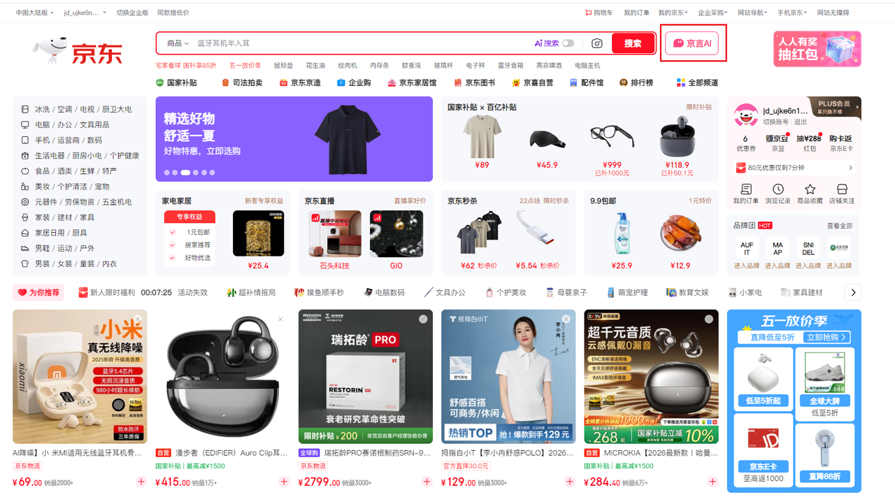
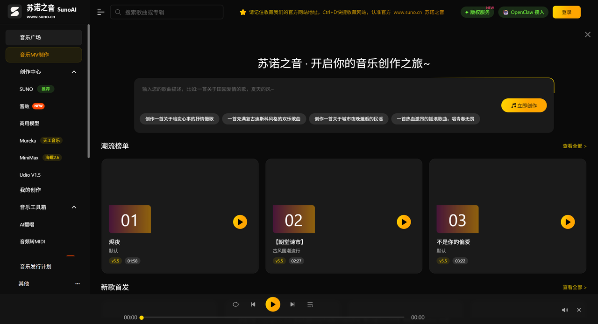
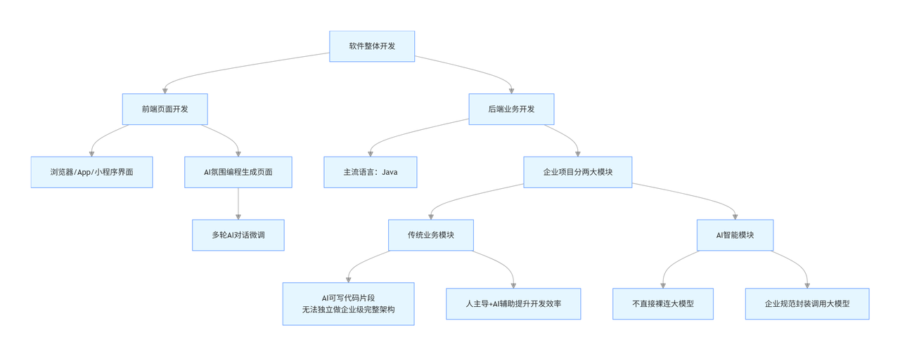
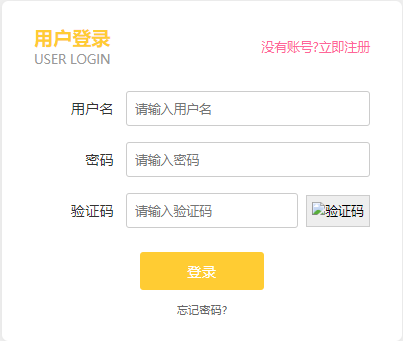
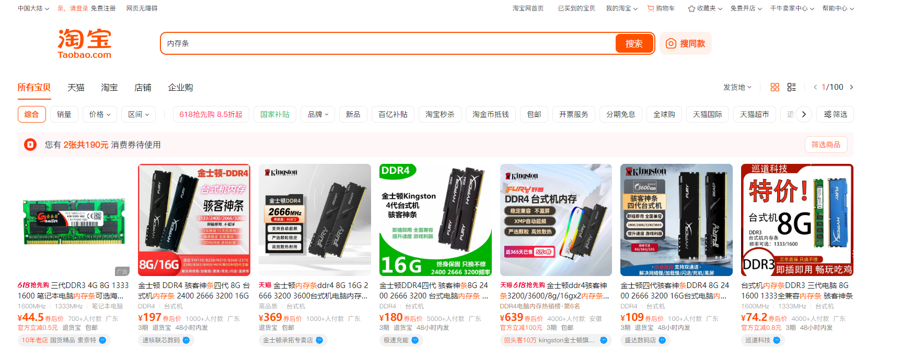
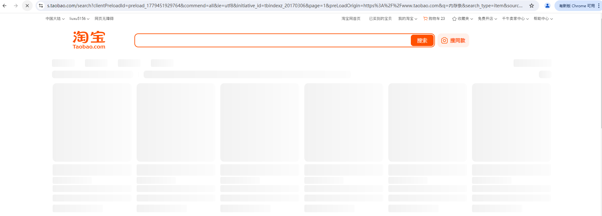
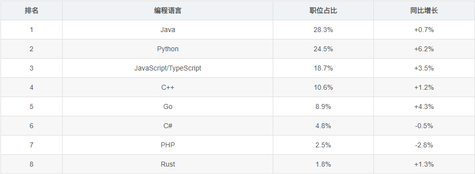
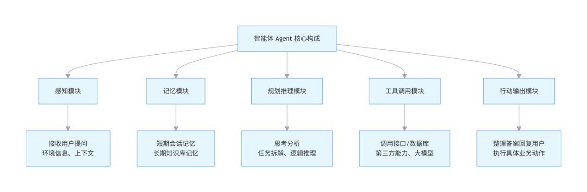
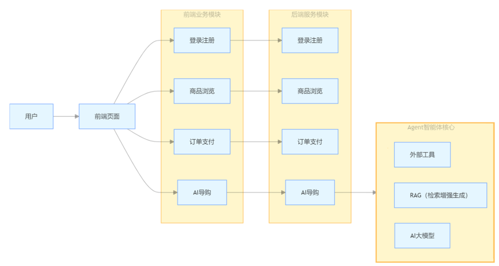

# 1. 智能应用开发的介绍

> 来自《初识智能应用开发》· [原文](https://baxsu7o100e.feishu.cn/wiki/UNDzwRlSliuvXZkIJ65clOOrnjh)

## 1.1 什么是智能应用开发?

误区：我们不是开发大模型本身，大模型内部的算法我们不学（难度大，学历要求高）

正解：利用目前AI大模型的能力，去开发智能软件（传统模块 + 智能模块）

其他称呼：智能软件/AI全栈/AI应用/大模型应用/Agent开发/智能体开发… 其实都是一样的

## 1.2 市面上智能应用开发分类

目前市面上智能应用开发可以分为两种：

- 传统项目的智能化升级
- 全新的智能软件开发

### 1.2.1 传统项目的智能化升级

举例1：京东商城

京东商城就是标准传统项目的智能化升级，整个项目中包含了传统业务和新增的智能业务。

- 传统模块：商品搜索，商品展示，购物车，商品下单，优惠券，支付等等

- 智能模块：AI导购，AI商品推荐，AI客服，AI虚拟试衣（研发中...）

> 补充一句：AI虚拟试衣功能目前在国外非常流行，短时间之内在国内基本无法流行起来，不是因为国内技术不行，而是因为国内快速且非常便宜的物流市场，还有用户的消费习惯。

### 1.2.2 全新的智能软件

举例2：音乐软件：AI音乐（suno）

这个就是一个全新的可以利用AI生成音乐的项目，整个项目中也依旧包含了传统业务和智能业务。

- 传统业务：充值，会员，歌曲展示，歌曲播放，歌曲搜索等等
- 智能模块：音乐创作，AI翻唱，人声背景分离等

其他业务场景：

音视频软件：即梦

外卖软件：智能点餐系统

物流软件：智能仓储管理系统

医疗软件：智能问诊辅助系统 / AI私人医生

小说软件：AI续写 / AI小说推荐

未来的趋势：

我们可以看到, 不管市面上哪一类的智能应用开发都离不开: 传统业务 + 智能模块 ,

而且AI可以帮我们解决绝大部分的传统模块学习困难, 耗费精力比较大的情况,  慢慢的趋近于自然语言编程

因此AI时代下，开发岗不再是科班生的专属，利用AI可以很快填补差距，而且更重要的是你可以做自己行业的智能应用

这也是程序员是最能吃到AI红利的人员之一。

## 1.3 这些软件是如何开发出来的？

知道这些软件是如何开发出来的，也就知道我们后面该学习哪些内容了，在试学班，我们先了解整体的项目架构，然后再分模块进行学习。

大体是分为以下几个模块：

### 1.3.1 前端页面：

什么是前端 ?

我们在使用软件的时候，打开一个浏览器，App，小程序，看到的其实就是前端部分，前端负责页面展示。

现在前端部分的开发方式，更多的是利用AI生成（氛围编程vibe coding），如果AI生成的效果不是我们想要的可以进行多轮对话，最终改成可接受的方案。

### 1.3.2 后端业务：

1. 什么是后端业务或者业务开发 ?

后端业务也叫开发后端业务，也叫做服务器端开发，更偏向于解决企业级的业务开发。

举例1：登录注册

用户在前端输入了用户名和密码，点击登录之后，前端会将数据发送给后端。

后端会判断用户名和密码是否正确，而判断的这个过程就是业务逻辑。然后后端再将判断结果返回给前端，前端展示登录成功或登录失败。

举例2：查询商品

用户在前端输入了"内存条"，表示我现在想要查询一下内存条这件商品，前端会把用户的请求发送给后端。

后端会在淘宝所有的商品当中去查询"内存条"，而这个查询的过程也属于业务逻辑。然后后端再把查询到的所有结果再返回给前端，前端展示所有的商品。

所以，这就可以解释，如果网络异常或者网络比较慢的时候，前端页面为什么一直刷新不出来数据。就是因为后端还没有把数据返回给前端。

综上所述：

- 前端：负责页面展示
- 后端：负责业务逻辑
2. 后端开发的模块划分 ?

后端开发不负责数据展示，主要负责处理项目中的业务逻辑。一个完整的企业级项目有多模块。

通过我们上一章节分析, 目前后端开发分成两类: 传统模块 和 智能模块

举例1：电商项目（传统模块 + 智能模块）

举例2：小说阅读项目（传统模块 + 智能模块）

那么后端业务，一般用什么编程语言来做呢？看下图

（数据来自于：2025年智联招聘和boss直聘发布《IT人才需求报告》）

后端开发也叫服务器开发，国内目前后端编程语言主流还是Java， 当然python也在崛起赶超, 如上图所示。

3. 传统模块开发现状：

目前很多人会想着依赖AI进行软件开发，事实上目前AI大模型的能力生成一个毕设程度的项目是可以的，但是还无法生成一个完整的企业级后端。经过大量测试，AI生成片段性代码是神，生成完整性结构代码AI往往比较拉跨。

所以，在传统业务中，我们一般是利用AI辅助我们开发提高开发效率。

总结: 传统模块中我们负责制定整个项目结构，技术选型等，一些片段性，功能性的代码，AI辅助完成。

那么智能模块的开发现状? 这个是我们本课程的含金点 我们分大章节来说明

## 1.4 智能模块的开发现状：

> 思考：智能模块是直接访问大模型吗？

> 答：不是的

### 1.4.1 企业中是如何使用大模型的？

直接使用大模型的弊端

以刚刚的场景为例，不管是哪种类型的软件，其实不外乎是传统业务 + 智能模块

其中智能模块并不是直接使用的大模型，因为如果是直接使用，那么跟我们用网页跟AI对话，其本质并没有太大的区别，而且大模型是有以下的弊端：

大模型本身的弊端：

- 数据不及时（现在最新的联网搜索也不是大模型本身的能力）
- 市面上现有的大模型基本都是通用大模型，专业领域的数据大模型可能不知道
- 大模型本身是无法直接调用外部工具的
- 多次对话没有记忆功能

例如:  可以利用网页版deepseek测试以下提问

1. 你学习的最新数据是截止到什么时候？DeepSeek回答：2026年5月。
2. 我今天上班吗？DeepSeek回答：留意内部通知。
3. 现在几点了？DeepSeek回答：不知道。
4. 打开A页面告诉大模型，我是XXX，重新打开一个对话再问我是谁，他就忘了。

企业中的解决方案：

在企业中，会把大模型认为是一个非常聪明的大脑，但是没有记忆，也没有手脚帮我们做事情。

所以，我们会在大模型的基础上，加上这些额外的功能。

那么大模型加上这些功能的整体，我们叫做智能体。是不是很抽象, 那么我们现在就剖析一下智能体是什么

### 1.4.2 什么是智能体？

斯图尔特·罗素与彼得·诺维格的《人工智能：现代方法》一书中曾说：

智能体（Agent）：是任何能够通过传感器感知其环境，并通过执行器对该环境施加影响的系统。

从而可以推导出智能体的四个关键能力：

- 感知：从环境中获取信息的能力。
- 执行：通过执行器将决策转化为实际的行为，从而对环境产生影响。
- 思考推理与决策：智能体的大脑，根据感知到的信息和自身的知识进行分析、规划、判断、决定下一步采取什么行动。
- 记忆学习与适应：智能体根据历史经验（感知-决策-执行的结果）来改进其未来的决策模型，从而在变化的环境中更好的实现其目标。

大白话解释智能体的每一部分：

- 智能体：可以想象成是一个人，藏在软件里面的电子牛马, 有脑袋, 有手,有脚可以干活, 当然是在虚拟的网络中干活哈
- 感知：就是把数据交给电子牛马让他做事情
- 记忆：给电子牛马加上记忆功能
- 思考推理：电子牛马的大脑，就是大模型
- 调用外部工具执行：电子牛马加上手脚，去做事情，查时间，查天气，订机票，酒店，外卖等
- 行动输出：电子牛马做完事情了，把结果告诉我们

你看，就这么简单~

以后的学习内容：

1. 如何从传统业务当中获取数据
2. 如何调用外部工具去做具体的事情
3. 如何利用现有的大模型去做推理和决策
4. 如何建立本地知识库实现记忆功能

简而言之：

AI Agent = 大模型 + 记忆 + 感知数据 + 调用工具行动

所以，整个的软件结构如下：

