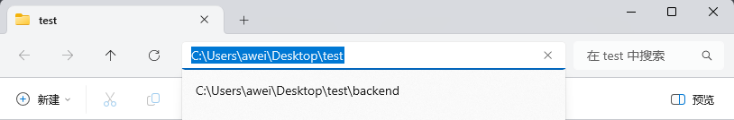
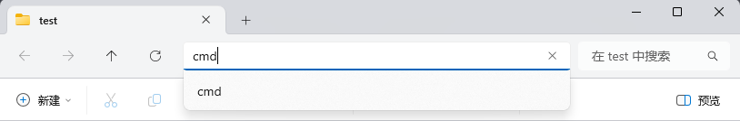
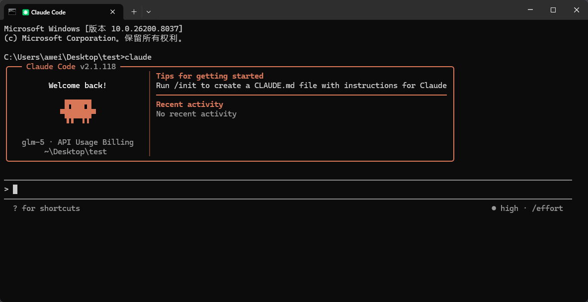
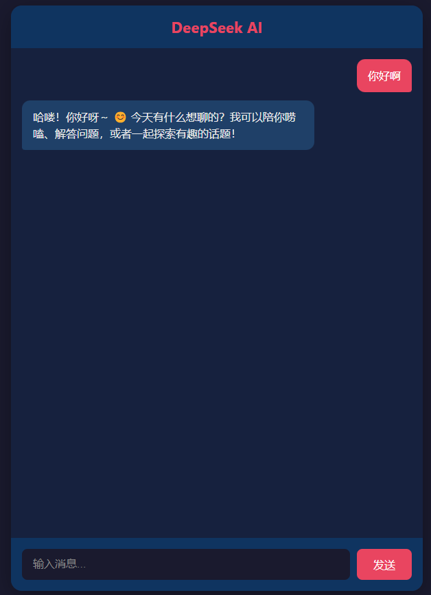
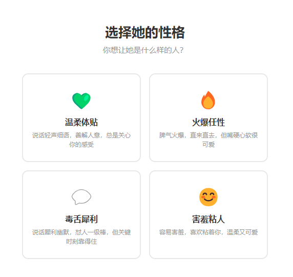
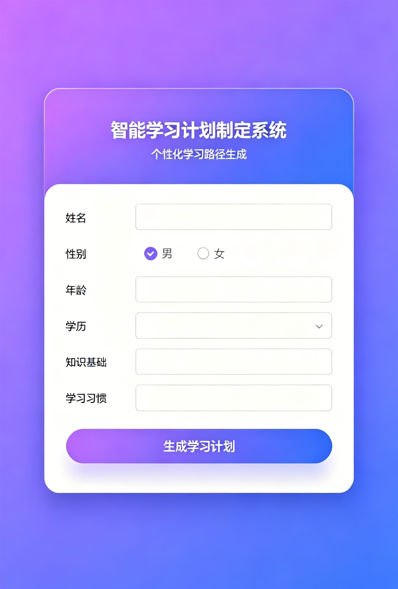

# 5. vibecoding（氛围编程）

> 来自《初识智能应用开发》· [原文](https://baxsu7o100e.feishu.cn/wiki/UNDzwRlSliuvXZkIJ65clOOrnjh)

## 5.1 概念解释

一种利用人工智能工具生成代码的编程方式。该概念由[OpenAI](https://baike.baidu.com/item/OpenAI/19758408?fromModule=lemma_inlink)创始工程师[安德烈·卡帕西](https://baike.baidu.com/item/%E5%AE%89%E5%BE%B7%E7%83%88%C2%B7%E5%8D%A1%E5%B8%95%E8%A5%BF/64971300?fromModule=lemma_inlink)于2025年2月首次提出。

通过AI模型理解开发者意图并生成代码，主要应用于快速原型开发、个人项目等场景。这种方式降低了编程门槛，

但也引发了关于代码质量、安全及对开源生态影响的讨论。

目前业内公认的使用方式是，可以利用vibecoding的方式生成自己的个人项目，如毕业项目，但是在企业级项目当中只能生成片段性的代码，不能完全依赖他。

## 5.2 常见的vibecoding工具：

claude code、codex、Cursor、Trae等，在我们的课程当中，我们会使用目前最好用的claudecode。

## 5.3 AI项目初体验

### 5.3.1 新建文件夹

在桌面新建文件夹test，我们会利用claude code在该文件夹下生成前后端的项目

### 5.3.2 启动claude code

在当前文件夹中打开cmd





启动claudecode



### 5.3.3 生成前后端项目

#### 5.3.3.1 需求一：

我要生成一个前后端的AI对话机器人项目

提示词一：

帮我在该文件夹下生成一个前后端的项目，AI对话机器人，前端用原生的html，css生成，利用axios对接后端，要注意前端的美观。后端利用uv进行python的项目管理，利用fastAPI跟前端进行对接，后端在对接大模型完成AI对话机器人的时候, 采用的是ANTHROPIC_API_KEY完成访问, 和claude code采用相同的API-KEY,以及大模型地址以及模型, 完成后端模型的对接

提示词二：

你帮我测试一下，前端，后端，大模型之间的接口是否畅通，如果无法联调成功，帮我进行修改，保证代码能成功运行。

提示词三：

利用uv启动一下后端服务

效果图：



测试完毕之后，让AI停止

提示词四：

停止后端服务

#### 5.3.3.2 需求二：

我要修改原本的项目

提示词一：

我现在要修改一下这个项目，要注意前端的美观，把他变成一个AI女友对话机器人，前端页面刚启动的时候会让你选择女友的性格，温柔，暴躁，犀利等，选择性格之后，输入自己给女友起的名字，最后再进入到AI对话机器人的聊天框中，此时AI就扮演我设定好的女友跟我对话，你帮我修改前端，后端相关的模块

提示词二：

你帮我测试一下，前端，后端，大模型之间的接口是否畅通，如果无法联调成功，帮我进行修改，保证代码能成功运行。

提示词三：

利用uv启动一下后端服务

> 注：如果项目启动之后，效果可能跟资料中不一样，这没关系，因为大模型生成的代码有不确定性，只要完成业务功能即可。

效果图：



测试完毕之后，让AI停止

提示词四：

停止后端服务

## 5.4 课后项目实战

需求：

利用今天所学，自己编写一个学习计划软件

前端页面效果如下：



效果解释：

姓名：后面是输入框，自己输入

性别：后面是单选按钮，自己选择

年龄：后面是输入框，自己输入

学历：后面是下拉框，下拉框的内容为：硕士及以上，本科，专升本，专科，其他，默认显示本科

知识基础：后面是输入框，输入自己会的计算机知识，比如：MySQL，C语言基础语法，不会就输入0基础

学习习惯：后面是输入框，输入自己的学习习惯，比如：早上昏昏欲睡，中午吃完饭犯困，晚上精神百倍

点击生成学习计划之后，将输入的信息发送给后端。

后端页面逻辑：

1. 接收前端发送过来的学生信息
  2. 先简单的初步判断 学历选择其他，不需要访问大模型，直接劝退。 给前端返回：同学，可以考虑其他非开发类的方向。
1. 学历选择其他，不需要访问大模型，直接劝退。 给前端返回：同学，可以考虑其他非开发类的方向。

给前端返回：同学，可以考虑其他非开发类的方向。

3. 将学生信息、黑马程序员真正的学习时间，黑马程序员的课程安排，一起发送给大模型。让大模型给出学习计划。（学习时间、课程安排如下）

学习时间：
目前跟着黑马程序员的课程学习，每天早上8点半到12点半，下午两点半到六点半，晚自习2~3个小时。两天上课一天自习/休息。

目前跟着黑马程序员的课程学习，每天早上8点半到12点半，下午两点半到六点半，晚自习2~3个小时。两天上课一天自习/休息。

课程安排：
第一阶段：vibecoding方式熟悉整个项目
第二阶段：利用python完成Agent开发
第三阶段：把Agent融入到企业级项目当中，Java开发业务版本，Python开发智能体
备注：因为学习时间和课程安排是固定的，所以直接保存在后端，不需要前端输入。

第一阶段：vibecoding方式熟悉整个项目

第二阶段：利用python完成Agent开发

第三阶段：把Agent融入到企业级项目当中，Java开发业务版本，Python开发智能体

> 备注：因为学习时间和课程安排是固定的，所以直接保存在后端，不需要前端输入。

4. 让AI给自己定制一个具体的学习建议，并给出可实施的方案，并把最终的结果保存到本地Excel中。文件名就叫做：未来半年学习计划。

```java
帮我在该文件夹下生成一个前后端的项目，智能学习计划智能系统，前端用原生的html，css生成，利用axios对接后端，要注意前端的美观。

前提:
该位学生准备在黑马程序员进行学习, 黑马程序学习的事件表如下:
每天早上8点半到12点半，下午两点半到六点半，晚自习2~3个小时。两天上课一天自习/休息。

前端需要包含:
姓名：后面是输入框，自己输入
性别：后面是单选按钮，自己选择
年龄：后面是输入框，自己输入
学历：后面是下拉框，下拉框的内容为：硕士及以上，本科，专升本，专科，其他，默认显示本科,学历选择其他，不需要访问大模型，直接劝退。
给前端返回：同学，可以考虑其他非开发类的方向。
知识基础：后面是输入框，输入自己会的计算机知识，比如：MySQL，C语言基础语法，不会就输入0基础
学习习惯：后面是输入框，输入自己的学习习惯，比如：早上昏昏欲睡，中午吃完饭犯困，晚上精神百倍
点击生成学习计划之后，将输入的信息发送给后端。让AI给自己定制一个具体的学习建议，并给出可实施的方案，并把最终的结果保存到本地Excel中。文件名就叫做：未来半年学习计划。


后端利用uv进行python的项目管理，利用fastAPI跟前端进行对接，后端在对接大模型完成智能学习计划智能系统的时候, 采用的是ANTHROPIC_API_KEY完成访问, 和claude code采用相同的API-KEY,以及大模型地址以及模型, 完成后端模型的对接
```

总结:

> 📋 本节含一块飞书画板/白板内容，文字无法直接转写，请查看原文档对应位置。
