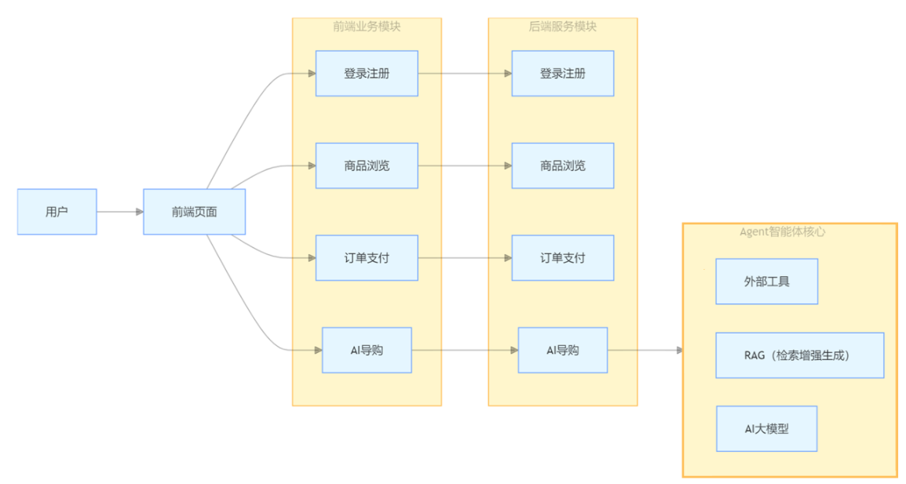
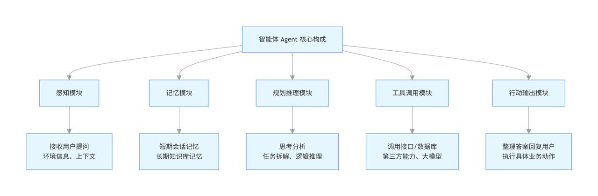

# 第3章 基于平台的智能体开发

## 本章信息

- 来源：[飞书原文档](https://baxsu7o100e.feishu.cn/wiki/BsS9w2DAZiOZmhkTfclcPJpgnEh)
- 最后修改：10月29日修改
- 本节数：6

## 本章概览

### 学习目标：

1. 理解大模型的局限性及Agent（智能体）的核心价值
2. 掌握Coze平台注册、积分规则及基础智能体的创建流程
3. 区分系统提示词与用户提示词，并能编写与优化提示词
4. 了解模型参数（温度、Top P）的作用与选择方法
5. 理解插件的概念，能为智能体添加并使用插件
6. 掌握JSON数据格式的编写规则，能解析插件输入/输出数据
7. 理解知识库的作用，能创建、导入文本/表格知识库并关联到智能体
8. 掌握开场白、预设问题、快捷指令等对话体验优化设置
9. 利用claude将发布的智能体集成到项目中

### 课程内容：

在之前的课程当中，我们已经利用vibecoding完成了多个项目的开发，整体的项目结果如下：

其中要注意的是：

真正的实际开发中，后端不会直接调用大模型，因为里面涉及的问题太多了。

- 数据不及时（现在最新的联网搜索也不是大模型本身的能力）
- 市面上现有的大模型基本都是通用大模型，专业领域的数据大模型可能不知道
- 大模型本身是无法直接调用外部工具的
- 多次对话没有记忆功能

所以，目前的大模型仅仅是具备了"思考"能力，能够帮助我们解决一些知识获取和推理等问题。但是因为大模型还有上述各种问题，能够帮助我们解决的业务问题有限。

但是，如果能让大模型具备记忆、使用工具等能力，将很大程度上拓宽大模型能力的边界。于是"Agent智能体"这个概念在业界出现并大火。

举例：

我下周三要去杭州出差，我想让AI帮我安排好行程

- 大模型：就像大脑，只能帮你制定完整的行程，但是并不会真正的帮你订机票，订酒店，不会真正的做事情。
- 智能体：相当于给大模型装上了手脚，自主完成查询航班、预订酒店、规划市内交通、提醒天气等一系列操作 。它不仅"有脑"（能思考），还"有手有脚"（能调用工具去执行）。

Agent的目标和理念：

让它成为一个能自主思考、能帮你办事的"智能大脑"或"数字员工"。

Agent智能体：

智能体的四个关键能力：

- 感知：从环境中获取信息的能力。
- 执行：通过执行器将决策转化为实际的行为，从而对环境产生影响。
- 推理与决策：智能体的大脑，根据感知到的信息和自身的知识进行分析、规划、判断、决定下一步采取什么行动。
- 学习与适应：智能体根据历史经验（感知-决策-执行的结果）来改进其未来的决策模型，从而在变化的环境中更好的实现其目标。

智能体的开发主要有两种方式：

- 基于平台开发（Coze & Dify）
- 基于python代码开发

那么在试学班我们就基于coze平台，不写一行代码，开发多个智能体。

| 技术栈 | 优势 | 劣势 |
| --- | --- | --- |
| Coze | 快速实现需求，低代码 | 限制较多，无法实现比较定制化的功能 |
| Dify | 快速实现需求，低代码，能够对接本地模型和服务 | 本地版插件太少，很多功能需要重新造轮子 |
| LangGraph等框架 | 扩展性极强，基本上不受限制，可以对接本地模型，实现自定义复杂逻辑等 | 从零构建 |

现阶段，企业中的Agent还处于过渡阶段，一般是以一个"流水线"的方式事先规定好业务流程，通过串联多个大模型负责处理不同的任务，从而解决一个复杂的业务场景。

而Agent的终极形态其实是不需要开发这些流水线，Agent能够完全自主完成我们的各种需求，这依赖于大模型的能力，目前来看还需要一定的时间。

而正是因为我们这个行业还要发展，所以现在还处于初期阶段。我们普通人才能入局，并且有很好的发展，如果一个方向的技术都已经固定，那么几乎就没有后来者的位置了。

## 本章目录

1. [Coze平台介绍](01-Coze平台介绍.md)
2. [扣子快速入门](02-扣子快速入门.md)
3. [智能体常见的设置](03-智能体常见的设置.md)
4. [发布](04-发布.md)
5. [课堂练习](05-课堂练习.md)
6. [课后项目实战](06-课后项目实战.md)

> 由飞书知识库自动转写整理，图片已本地归档至 `assets/`。
