# 4. 发布

> 来自《基于平台的智能体开发》· [原文](https://baxsu7o100e.feishu.cn/wiki/BsS9w2DAZiOZmhkTfclcPJpgnEh)

## 4.1 什么是发布？

发布：将自己的智能体公开发表到应用商城中

解释：

- 不发布：只能自己账号使用
- 发布后：任何人都可以在应用市场搜索到智能体，并进行使用

这就像我们平时手机上用的各种App软件，如果不发布，只能是程序员自己使用。

App一旦发布，就相当于上传到手机的应用市场，我们就可以搜索下载并使用了。

那么Coze的智能体发布也是一样的道理

### 4.1.1 智能体发布（扣子商店）

1. 点击右上角发布按钮


2. 选择发布渠道

Coze的智能体可以发布在很多地方，现在我们学习下面两种：

- 扣子商店
- API方式（对外提供一个接口，对接到我们的项目当中）

把这两个勾选上，我们先说发布到扣子商店

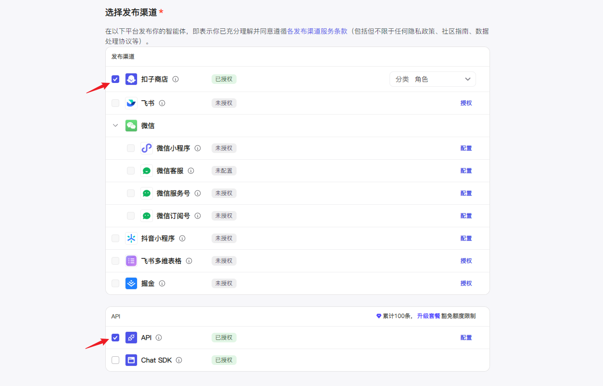

3. 按照实际情况选择分类

我们现在做的是夸夸群群主，属于角色扮演类的，所以选择角色

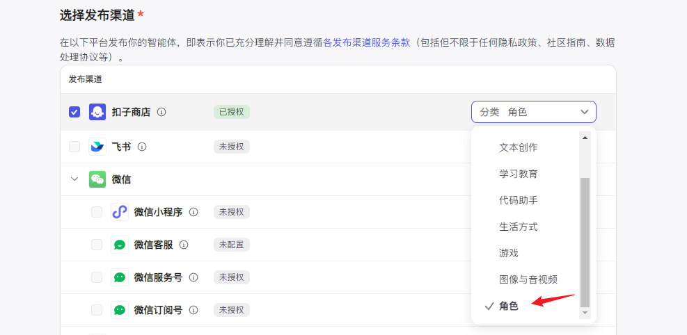

4. 发布记录可以写，也可以不写。
5. 点击右上角发布

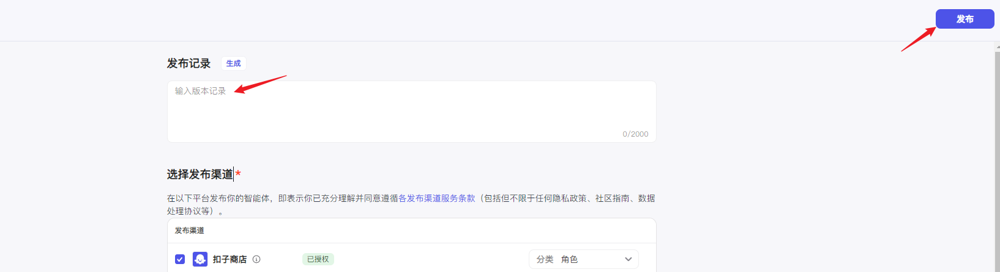

6. 发布成功

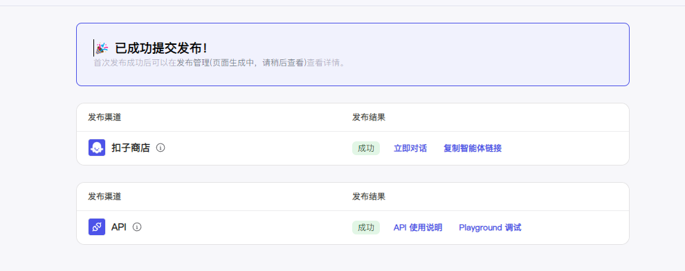

7. 查找作品

在作品社区中搜索：夸夸群群主，就能看到我们的作品了

点击进去就可以使用了。

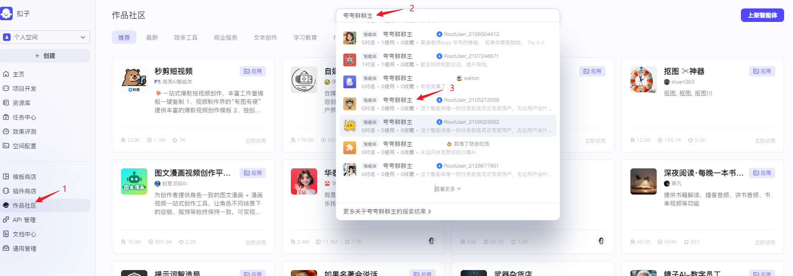

### 4.1.2 智能体发布（API）

API：可以用Java或者python等编程语言直接对接coze

好处：使用智能体不需要打开coze，把coze当做智能模块融入到项目当中。
学会了这个之后，我们利用vibecoding开发出来的项目就是既有传统业务，又真正的带  有智能业务了。

学会了这个之后，我们利用vibecoding开发出来的项目就是既有传统业务，又真正的带  有智能业务了。

1. 准备个人令牌

个人令牌其实就是你的身份，不能让一个身份不明的人随便调用我们的智能体

选择API管理 --- 点击授权 --- 点击个人访问令牌

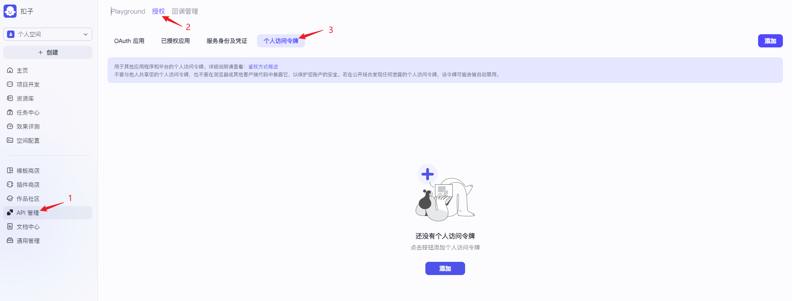

点击添加

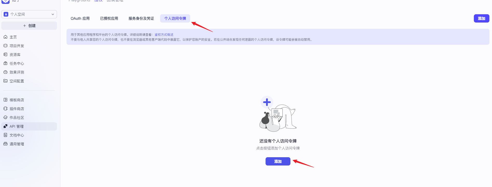

选择过期时间30天 --- 点击全选 --- 选择个人空间 --- 点击确定

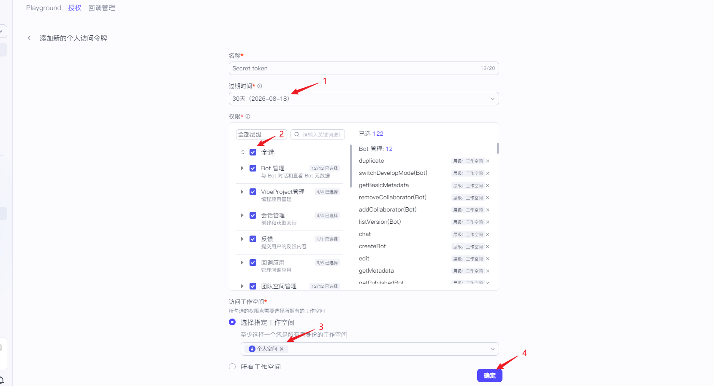

关闭窗口

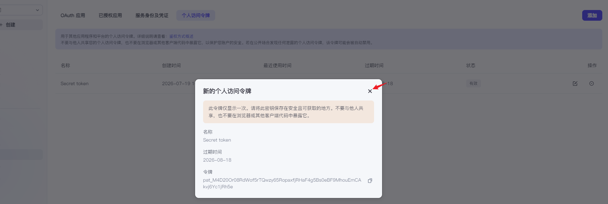

2. 发布智能体

回到智能体页面中，点击右上角的发布

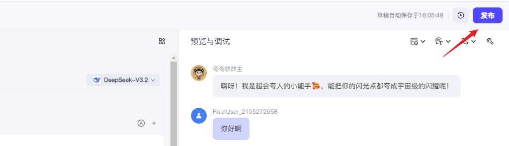

3. 勾选API

因为刚刚我们已经配置过个人令牌了，所以后端的配置不需要点击

但是如果刚刚没有配置个人令牌，这里需要点击配置，操作方式跟第一步一致

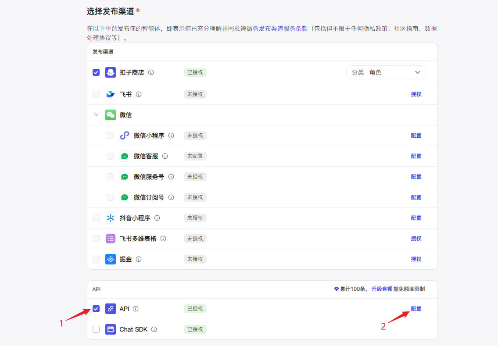

4. 直接点击右上角的发布

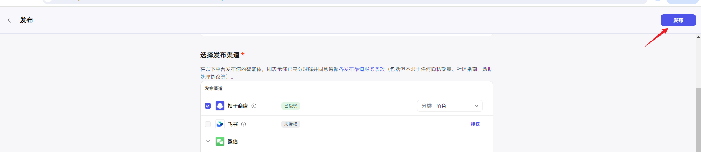

## 4.2 把Agent融入到项目当中

在刚刚我们已经把Agent发布到扣子商城，也以API的方式发布了，这两种方式的区别如下：

- 发布商城：其他人可以在扣子商城里面搜索并使用
- 发布API：可以用代码接入Coze，把Agent融入到我们的项目当中

项目对接coze智能体步骤：

1. 调试

在刚刚的发布页面当中，点击Playground调试，会自动调整到调试页面。

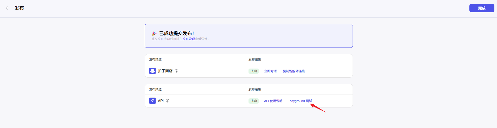

如果不小心关闭了，也没关系点击发布左侧的三个点，再点击API

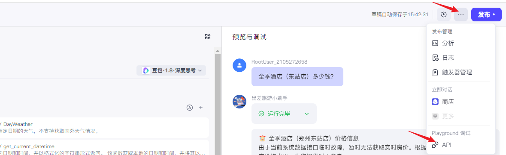

此时会跳转到调试页面

token：不是大模型的消耗的单位，而是指个人访问令牌

bot_id：智能体的id

user_id：与智能体对话的用户

stream：智能体回复是否为流式
流式：打字机效果，一段一段的出现
非流式：所有文字全部生成完毕，一次性展示

- 流式：打字机效果，一段一段的出现
- 非流式：所有文字全部生成完毕，一次性展示

这些数据都coze都帮我们添加好了，不需要修改，直接点击右边的运行
正常：下面都是绿色的
错误：下面有红色的，需要修改中间输入的值

- 正常：下面都是绿色的
- 错误：下面有红色的，需要修改中间输入的值

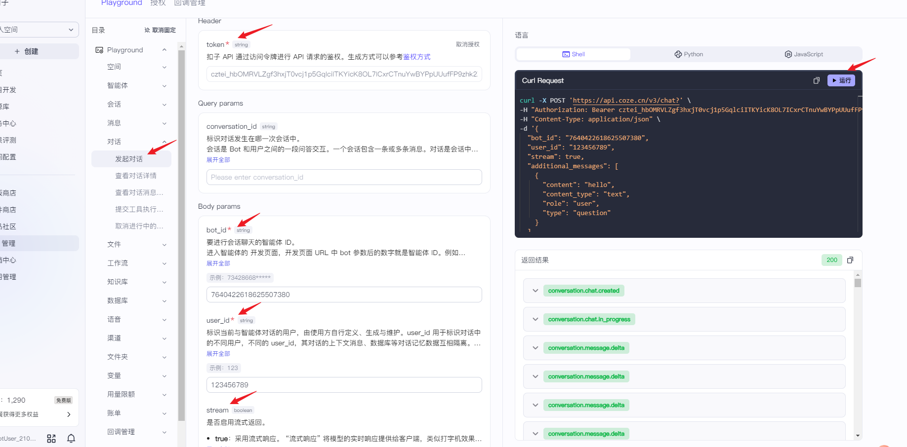

如果一切正常，点击复制按钮，把下面这个示例代码交给claudecode参考

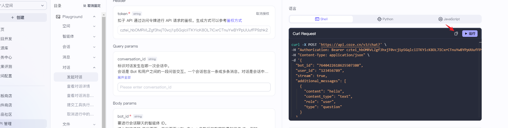

> 注意：

> 一定要先调试，再把示例代码交给claudecode，否则代码无法对接成功。

2. 把coze智能体融入到项目当中
- 可以写一个新的聊天创建对接coze
- 也可以在原来的项目中对接coze

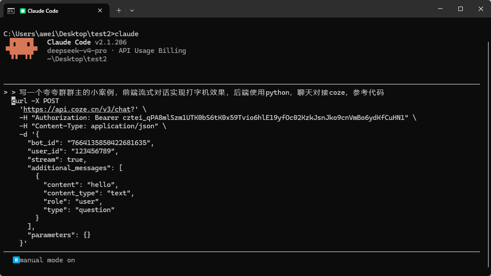

## 4.3 蒸馏自己的Skill

你会发现，用代码对接coze中间遇到的问题很多，我们需要反复的沟通。

但是这个操作在以后，我们会经常使用，所以可以把这个技能蒸馏为skill，以后claudecode就可以参考了。

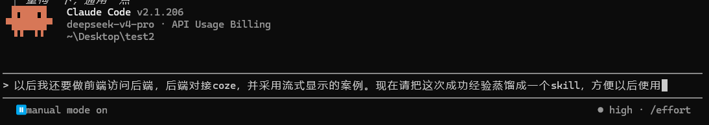

生成完毕之后，我们自己要阅读判断他的合理性。

要检查的点：

- skill.md需要是中文的
- 检查描述中的触发词
- 示例代码是做参考的，需要放在`references`文件夹中
- 这个Skill应该是流式聊天的通用技能，跟用什么技术无关，而现在生成的代码作为其中一个参考案例

今天的资料中有蒸馏好的Skill

迭代自己的skill：

迭代：就是不停的更新。

skill不是一次性就可以把所有的问题都罗列出来的，后续如果对接coze出现问题了，可以不断的更新skill，这样就可以让对接coze变得越来越丝滑。

> 注：以后我们遇到同样复杂的，且反复要做的事情，也可以用这次的办法蒸馏、迭代skill

1. 分析问题

```json
你这次对接coze遇到了什么问题？为什么没有一次性成功？
```

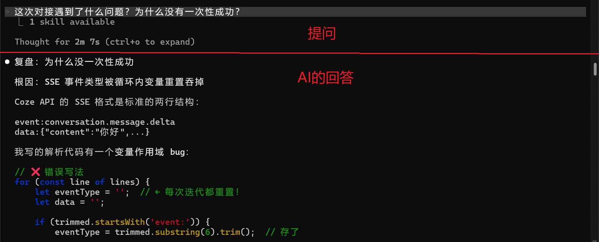

2. 添加这次遇到的问题

```json
skills里面有一个对接coze的skill，叫做：coze-chat的skill，你读一下这个skill，把这次遇到的问题添加到coze-chat里面，提高下次对接coze的成功率
```

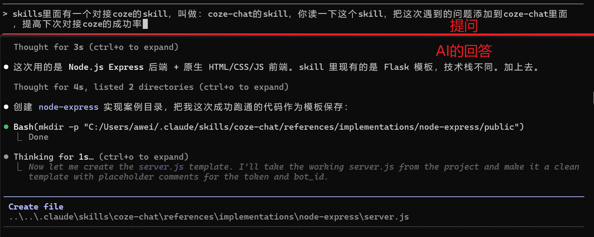

3. 添加示例代码

```json
这次你用的什么技术对接的coze？coze-chat这个skill里面有示例代码，如果你现在用到的技能跟coze-chat里面的示例代码不一样，可以把这次成功案例也放进去，给下一次提供参考
```

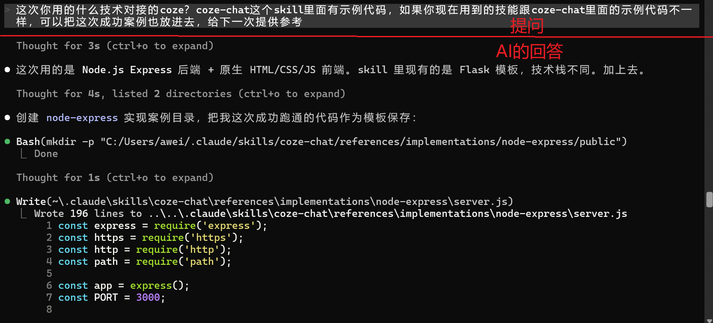

> 注：skill更新的越多，一次性成功的概率就越高
