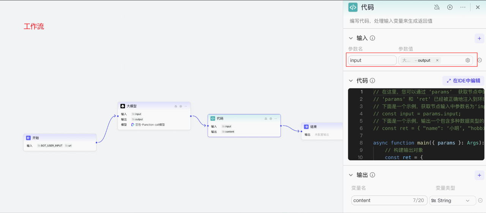
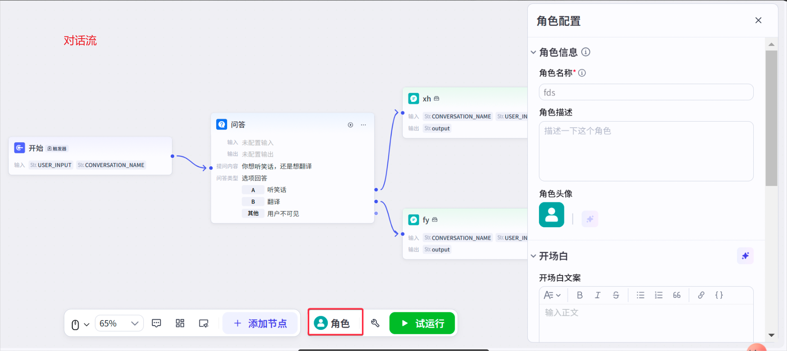
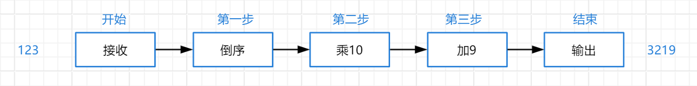
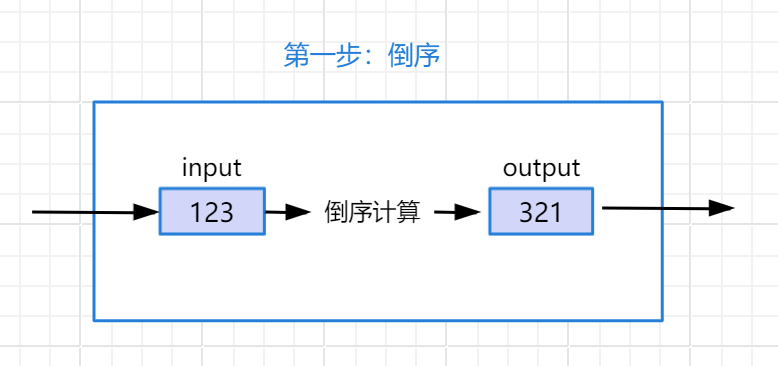

# 1. 工作流基础知识

> 来自《工作流》· [原文](https://baxsu7o100e.feishu.cn/wiki/RVNmwZZsPiqV0kknZrxcrWKHnfU)

## 1.1 工作流介绍

工作流：可以理解为工作的流程，其设计理念跟工厂的流水线是一样的，会严格按照指定的步骤执行。

工作流是coze平台最核心的功能，在实际工作中，几乎所有的功能都需要基于工作流实现。

我们在之前学习的插件、知识库等这些核心功能，在实际开发时，也可以用在工作流当中。

### 1.1.1 举例：数学计算

需求：

假设，现在全班50名同学参加期末考试，我要知道比平均分低的是哪几位同学？如何用工作流实现？

实现步骤：

1. 拆步骤 第一步A：计算全班50名同学的总分 第二步B：计算全班50名同学的平均分 第三步C：挨个比较

第一步A：计算全班50名同学的总分

第二步B：计算全班50名同学的平均分

第三步C：挨个比较

2. A -> B -> C 这个整体就是一个简单的工作流，但是仅仅是工作流的一个片段

为什么说是片段，不急马上就会有讲解。

白话：

工作流其实就是将复杂的任务， 拆分子任务，以节点的形式的体现， 我们可以通过节点和节点编排任务的逻辑顺序， 强制智能体按照我们事先准备好的逻辑顺序执行， 不会跳过任何的步骤

### 1.1.2 工作流和对话流：

工作流：用于处理功能类的请求，可通过顺序执行一系列节点，从而实现某个功能。适合数据的自动化处理场景，例如生成行业调研报告、生成一张海报、制作绘本等。

对话流：是基于对话场景的特殊工作流。支持角色的设置，更适合处理对话类请求。对话流通过对话的方式和用户交互，并完成复杂的业务逻辑。对话流一般用在类似于聊天机器人需要处理对话的应用当中。

例如个人助手、智能客服、虚拟伴侣等。

## 1.2 工作流中的重要概念

### 1.2.1 概念

- 节点：流程里面的每一个步骤也叫做节点。
- 开始节点：工作流里面的第一个节点，只负责接收数据，不做任何处理。
- 结束节点：工作流里面的最后一个节点，只负责输出数据，不做任何处理。
- 输入：当前节点接收到的数据，该数据是由前面的节点传递而来的。
- 输出：当前节点的计算结果，会把该结果输出交给后面的节点。
- 变量：节点里面临时记录数据的单元。

> 注：先理解前五个，变量一会细嗦

#### 案例：数据加密

我们通过一个实际的案例去理解前五个概念。

需求：

我现在要给数字进行加密，加密规则如下：

- 先将数据倒序排列
- 再将数据乘10
- 最后再加9

要求：把这个计算过程以工作流的形式进行表示

步骤很简单：

1. 倒序排列，把123变成321
2. 数据乘10，把321变成3210
3. 最后再加9，把3210变成3219

完整的工作流是怎么样的呢？

很简单，只要加上头尾节点即可

> 开始节点 --> 第一步 --> 第二步 --> 第三步 --> 结束节点

注意点：

1. 开始节点不做任何数据处理，只负责接收数据，把接收到的数据传递给后面节点
2. 结束节点不做任何数据处理，只负责输出最终的结果
3. 输入：每一个节点都有输入数据
4. 输出：每一个节点都有输出数据

工作流的执行流程：

由开始节点接收到数据之后，一步一步的往后执行，最终得到结果。

> 注：在工作流当中，每一个节点的输入数据可以是前面所有节点的输出数据，不一定是按顺序获取

### 1.2.2 节点中的变量

好，那么到目前为止，我们已经利用一个案例，学习了工作流、工作流中的节点以及在工作流中整体的数据传输。

那么接下来，还有最后一个重要的概念就是变量，要注意的是：变量位于节点里面的。

变量：节点里面的临时记录数据的单元。

我们以第一步要执行倒序的节点为例，放大内部是这样的：

input：就是变量名，可以理解为是一个临时记录数据的单元

首先：拿着input变量去记录当前节点接收到的数据

其次：拿着input记录的数据进行倒序数学计算

计算完毕之后，把结果存储到另外一个变量output当中

最后：把output变量中记录的数据输出

### 1.2.3 变量类型 String 一段话, 字符串,现实生活的一段话"{ \"name\":\"梅军建\" , \"age\":\"18\" }" Integer 整数 Number 数字(整数和小数) Boolean 只有True和False Object 对象格式{ "name":"梅军建" , "age":"18" } Array格式:  [ String, (Number, Integer), boolean, null , 对象, 数组  ] File格式: 文件格式

1. String 一段话, 字符串,现实生活的一段话"{ \"name\":\"梅军建\" , \"age\":\"18\" }"
1. Integer 整数
1. Number 数字(整数和小数)
1. Boolean 只有True和False
1. Object 对象格式{ "name":"梅军建" , "age":"18" }
1. Array格式:  [ String, (Number, Integer), boolean, null , 对象, 数组  ]
1. File格式: 文件格式
