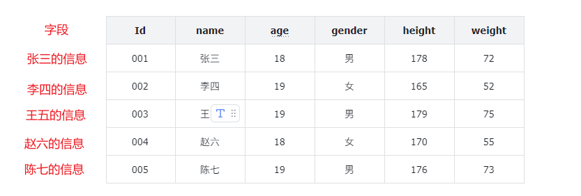

# 1. 数据库

> 来自《Coze的进阶使用》· [原文](https://baxsu7o100e.feishu.cn/wiki/KzUPwnjIsinaN7kB2JRcWuhrnZ7)

## 1.1 什么是数据库？

数据库（Database）是按照数据结构来组织、存储和管理数据的仓库。它是一个长期存储在计算机内的、有组织的、可共享的、统一管理的大量数据的集合。

> 简单理解：就是数据存储的仓库，类似于Windows操作系统中的文件夹。

## 1.2 什么是数据表？

数据表（Table）是数据库中最基本的数据组织单位，它采用二维表格的形式来存储数据。数据表由行（Row）和列（Column）组成：

- 列（字段/Field）：定义数据的属性，如姓名、年龄、性别等，每个列都有明确的数据类型
- 行（记录/Record）：代表一条完整的数据记录，包含所有字段的值

他就是一个表格，如果我们要存5个学生的信息，数据表长这个样子：

| Id | name | age | gender | height | weight |
| --- | --- | --- | --- | --- | --- |
| 001 | 张三 | 18 | 男 | 178 | 72 |
| 002 | 李四 | 19 | 女 | 165 | 52 |
| 003 | 王五 | 19 | 男 | 179 | 75 |
| 004 | 赵六 | 18 | 女 | 170 | 55 |
| 005 | 陈七 | 19 | 男 | 176 | 73 |

总结：

数据库，数据表，数据三者关系如下。

- 数据库：存储数据的仓库，就跟Windows的文件夹类似，他里面有很多数据表
- 数据表：就是一张表格，就跟Windows的txt文本文件类似，是用来真实存储数据的。
- 数据：存储在数据表里面的真实数据

## 1.3 数据表的结构

以刚刚的数据表为例：

第一行：id、name、age、gender、height、weight是数据的属性，专业叫做字段。

下面的每一行：同一个学生的完整数据

## 1.4 数据库和知识库的区别

数据库的概念很好理解，但是我们发现这个样子很熟悉啊。之前我们学习知识库的时候，用设计到表格的概念。

那么知识库中的表格，和数据库有什么区别呢？其实很简单。

- 知识库：一般只做查询处理，存放大模型不知道的数据。
- 数据库：可以增删改查。真实的开发中，用来保存业务数据的。

举例：法律咨询项目

- 法律咨询的智能项目当中，很多法律案件是专业信息大模型不知道，这个时候可以把这些法律案件信息存放在知识库当中。
- 但是在这个智能项目当中，用户的用户名，密码，手机号，邮箱，包括咨询时的聊天记录，这些是业务中产生的数据，就需要保存在数据库当中，方便随时进行增删改查。

总结：

- 知识库： 大模型的补充知识，存放大模型不知道的内容（比如：法律条文、公司手册等），主要用来查阅，很少改动。

大模型的补充知识，存放大模型不知道的内容（比如：法律条文、公司手册等），主要用来查阅，很少改动。

- 数据库：

业务中产生的需要永久存储的数据（比如用户信息、订单记录），需要随时新增、修改或删除，操作很频繁。
