# 2. Coze中的数据库

> 来自《Coze的进阶使用》· [原文](https://baxsu7o100e.feishu.cn/wiki/KzUPwnjIsinaN7kB2JRcWuhrnZ7)

在Coze当中，我们可以在智能体中直接使用数据库，也可以在工作流中使用数据库，方式都是一样的。

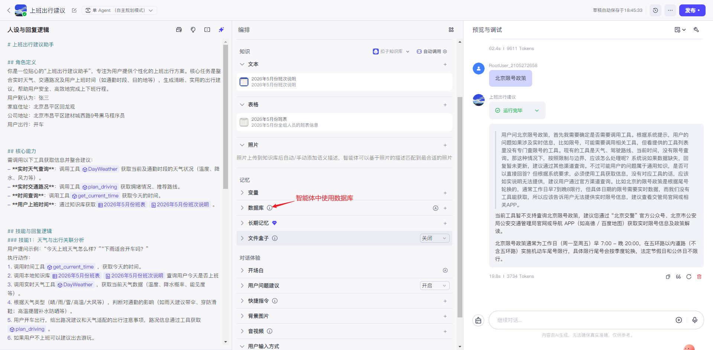

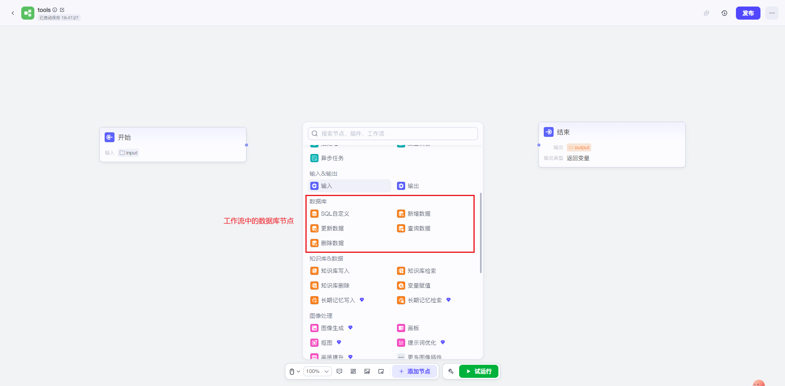

接下来，我们用一个小案例，帮助大家理解怎么在Coze中使用数据库。

案例：

公司绩效数据的处理（包含增删改查等操作）

## 2.1 创建一个数据库

不管是在智能体中使用，还是在工作流里面使用，都需要先在资源库中进行创建。

所以，我们要点击资源库，再点击右边的数据库

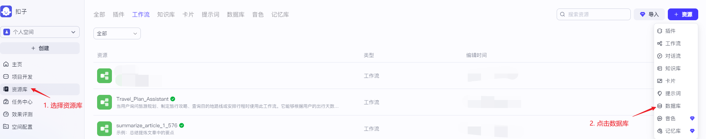

选择创建扣子数据库

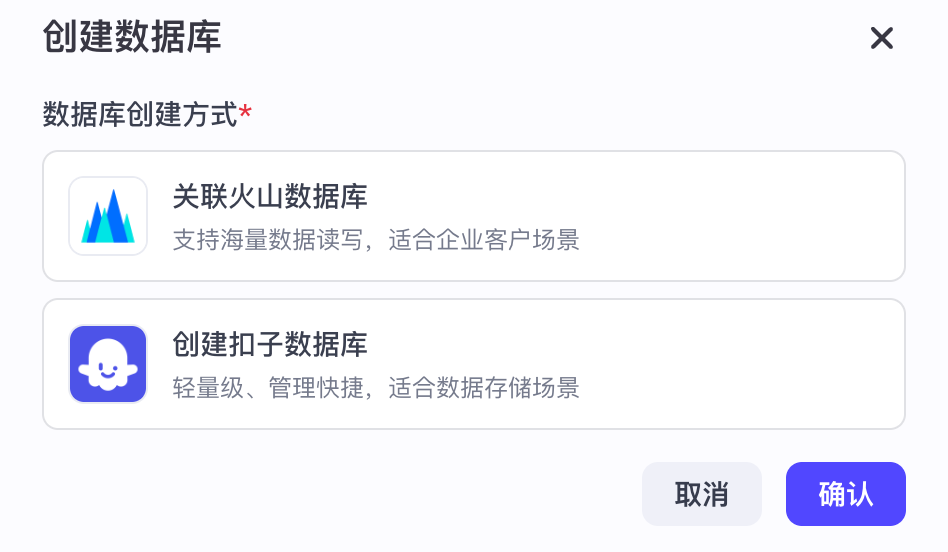

对比如下：

- 扣子数据库：扣子官方数据库，提供了类似传统软件开发中数据库的功能，允许用户以表格结构存储数据。
- 火山数据库：主要帮助企业简化繁杂的数据库管理和运维任务，使企业有更多的时间与资源聚焦于自己的核心业务。

在这里我们使用扣子数据库。对于使用coze大部分场景来讲，扣子数据库足够应对。

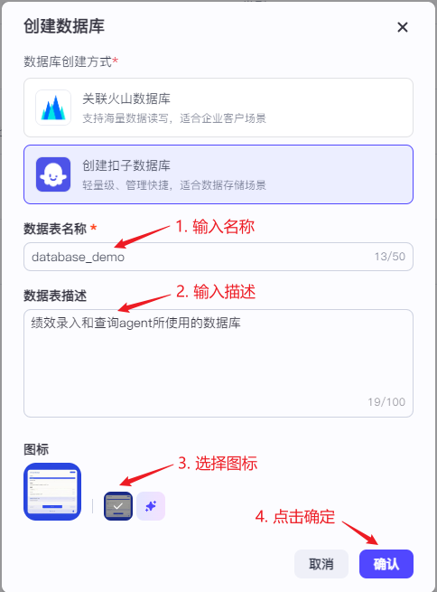

## 2.2 设置表结构

### 2.2.1 查询模式

创建数据库表以后，这里需要注意：

- 单用户模式：只能对自己创建的数据进行操作。
- 多用户模式：可以对所有人创建的数据进行操作。

默认选择单用户模式

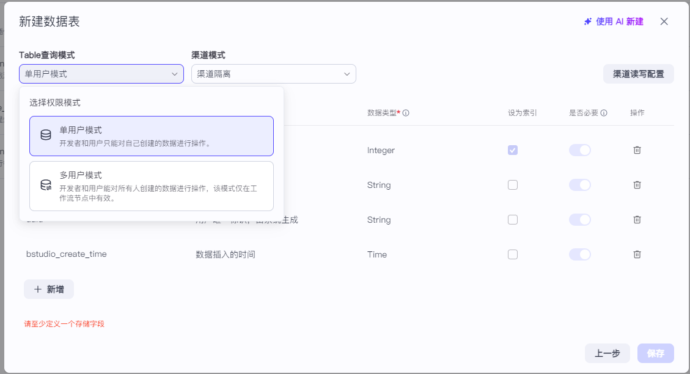

### 2.2.2 渠道模式

渠道：以后智能体可以发布在Coze，微信，飞书等，每一个平台都是一个渠道。

如果是渠道隔离就表示每个平台上的数据不互通，不能互相操作

默认选择"渠道隔离", 我们选择"扣子站内渠道共享, 其他渠道隔离"

注意:

```java
渠道隔离: 渠道只能是"扣子"类型才能查询

扣子站内渠道共享, 其他渠道隔离: 扣子站内都可以访问
```

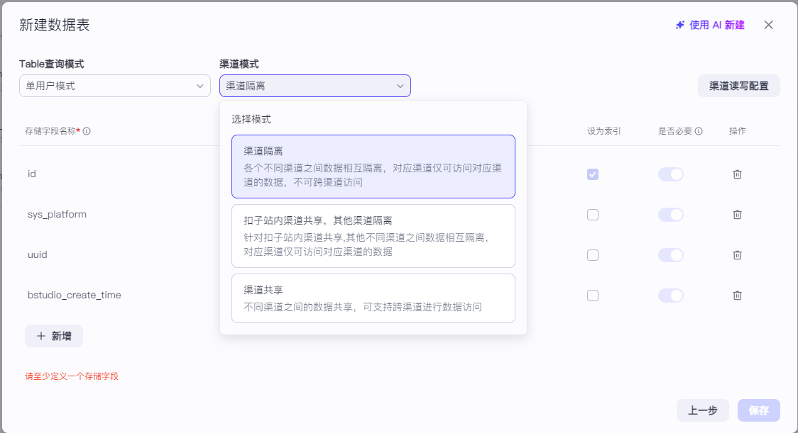

### 2.2.3 存储字段

新建一个数据表，结构如下图：

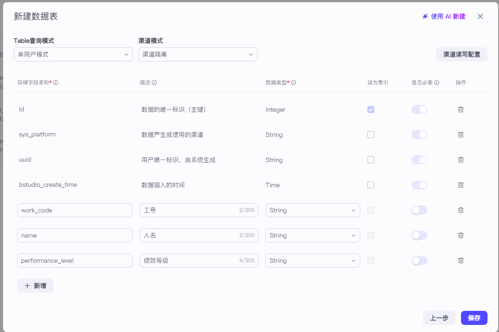

这里需要注意：

- id、sys_platform、uuid、bstudio_create_time 字段为系统内置

下面是我们自己添加的字段

- work_code：工号，类型String文本
- name：人名，类型String文本
- performance_level：绩效等级，类型String文本

点击保存按钮，就完成表的创建。

> 注：字段名尽可能一致，如果要修改，请将资料里面数据表的字段名一起修改

### 2.2.4 批量导入数据

有了表结构以后，接下来我们导入数据。在测试数据中，点击批量导入。

这里需要注意，数据库分测试数据和线上数据两个环境，这两个环境相互隔离：

- 测试数据：用于在发布之前调试使用， 和线上数据互相不影响
- 线上数据：发布后。从应用商店、api等各种渠道调用时使用。

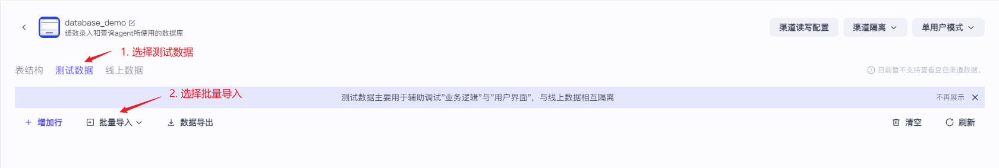

导入渠道选择：扣子

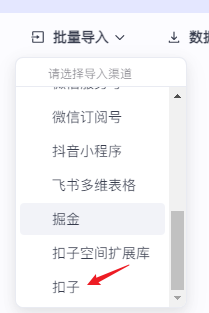

并把我们的素材《绩效数据.xlsx》文件上传。

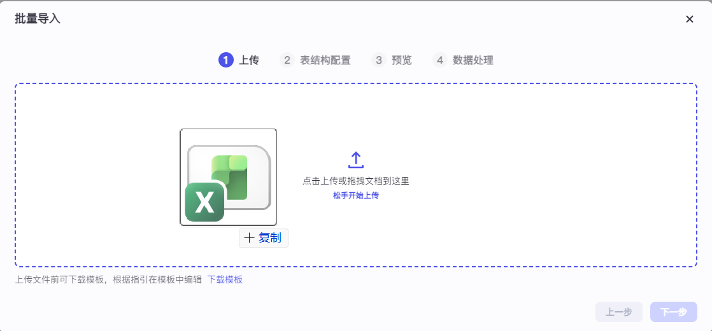

上传成功点击下一步

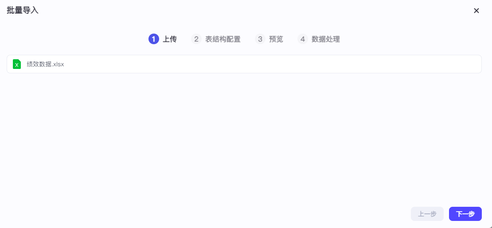

配置表结构，表头选择第1行、数据起始行选择第2行

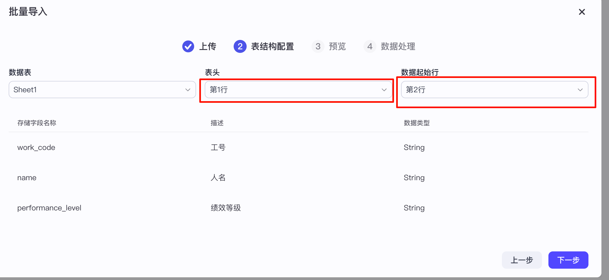

对应原文件：

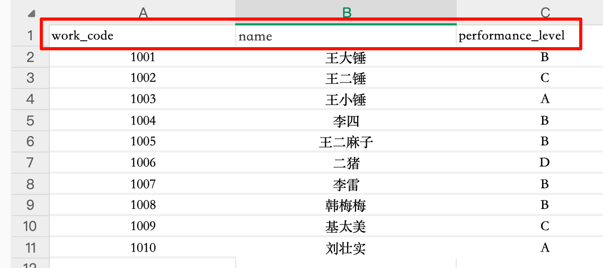

预览数据，无误后点击下一步即可。

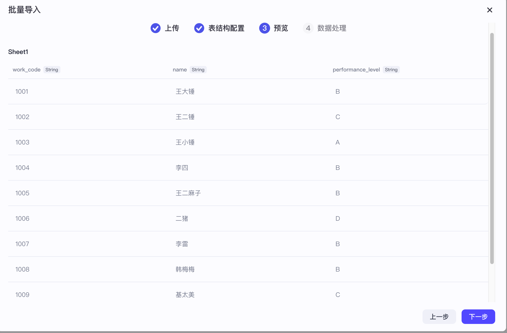

一共10条数据，确认数据已经完全写入：

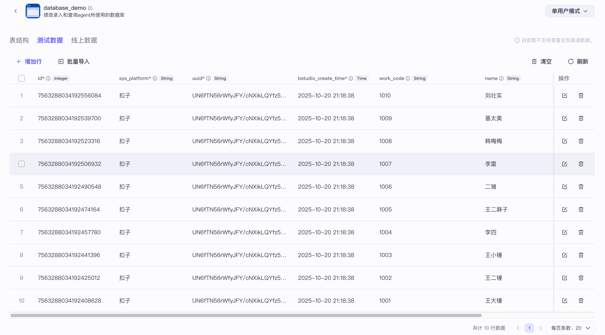

## 2.3 工作流中使用数据库

### 2.3.1 创建工作流

回到主页，新建工作流

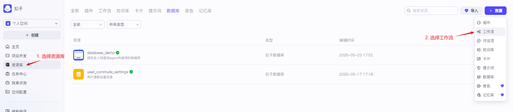

编写工作流的名字、工作流的描述

点击确定创建工作流

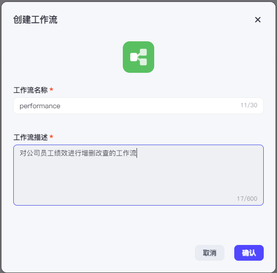

### 2.3.2 意图识别

因为我们要对数据进行增删改查四种操作，所以添加意图识别节点

如下图：

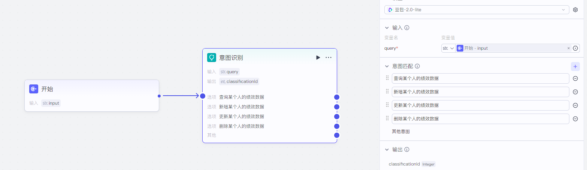

分为以下几个意图：

- 查询数据：查询某个人的绩效数据
- 新增数据：新增某个人的绩效数据
- 更新数据：更新某个人的绩效数据
- 删除数据：删除某个人的绩效数据

整体业务流程如下图：

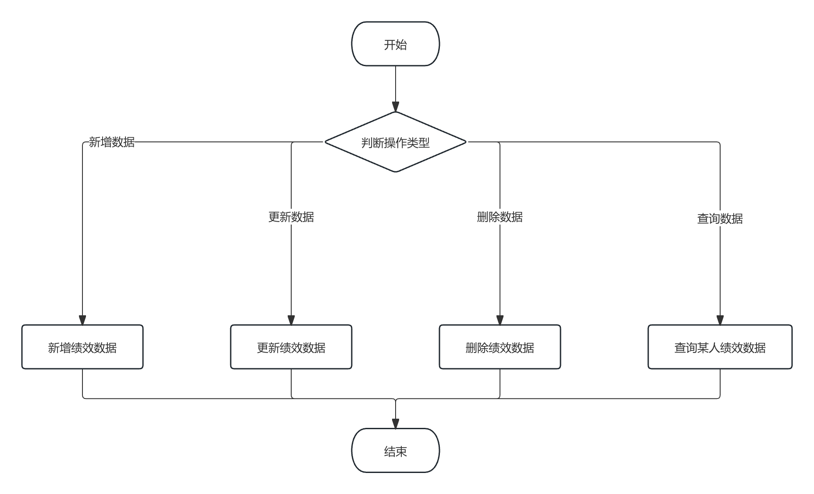

### 2.3.3 提取信息

在实现增删改查数据之前，我们需要先研究一下数据库的节点，他有以下五个：

- SQL自定义：需要写代码，就业班内容
- 新增数据：现在学习
- 更新数据：现在学习
- 查询数据：现在学习
- 删除数据：现在学习

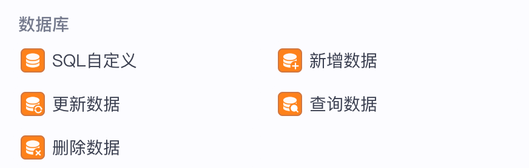

如果我们要进行查询操作，我们可以发现一个问题，就是你要查谁？比如：

> 用户输入： 帮我查一下张三的绩效是多少

这里就会涉及到一个问题，我们需要把张三这个人名从prompt中提取出来，如何完成呢？

很简单，我们要先添加一个大模型的节点，提取人名，然后再进行操作。

操作如下：

- 添加大模型结果
- 节点名称：修改为人名提取器
- 输入数据：关联开始节点的input
- 系统提示词：当前大模型的人设与回复逻辑
- 用户提示词：就是提取之前的原始内容
- 输出数据：提取之后的结果

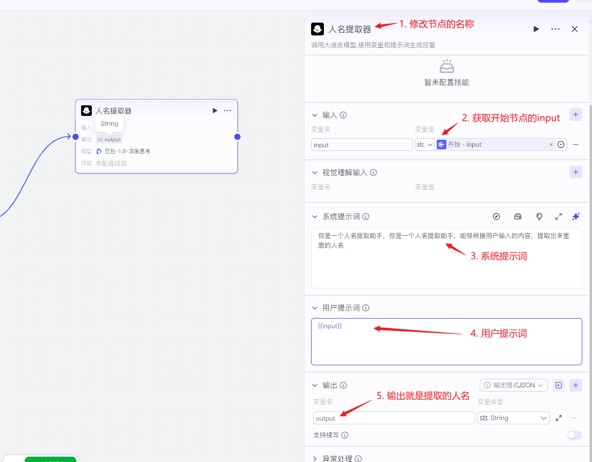

这种场景在生活中其实非常常见，比如我们在快递程序中输入一串人名、地址、手机号的一段话。

点击智能识别，快递程序就可以帮助我们把这些数据进行解析，并填到对应的表格中。

这里就涉及到了一种自然语言处理算法中常见的方法，叫做"命名实体识别"，也可以叫做"实体提取"，这里我们了解就行，后续会有其他课程进行深入讲解。

在这里，我们可以使用大模型的能力实现这个功能。

比如：从用户输入的input中提取人名，执行以下三步：

- 大模型节点输入数据：关联开始节点的input变量
- 大模型节点提示词：你是一个人名提取助手，你是一个人名提取助手，能够根据用户输入的内容，提取出来里面的人名
- 大模型节点输出数据：output保持默认，类型String文本，输出人名

点击小三角，单独试运行该节点，结果如下：

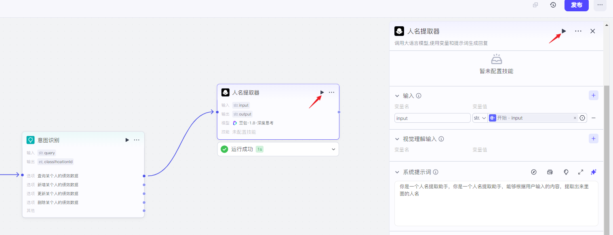

成功提取

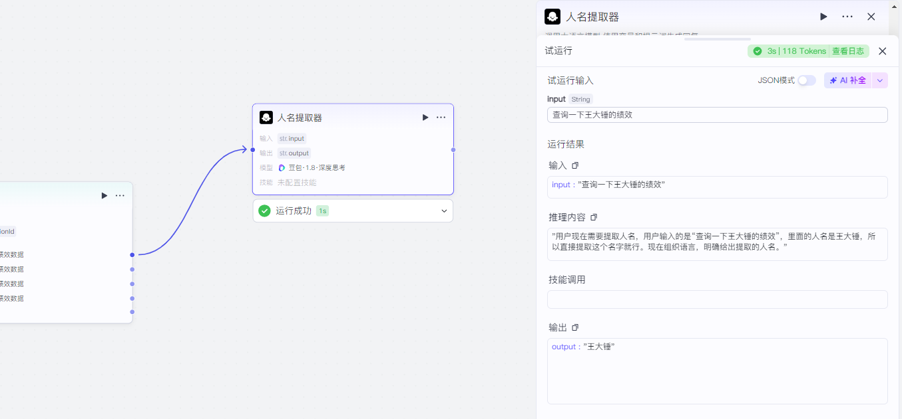

### 2.3.4 查询数据

到目前为止，我们已经有以下节点：

- 开始节点
- 意图识别节点
- 提取人名的大模型节点
- 结束节点

现在我们要完成查询数据，还要添加两个节点：

1. 数据库查询节点：查询数据
2. 大模型节点：整理查询之后的结果，让结果可读性更好

完成业务后整体如下图：

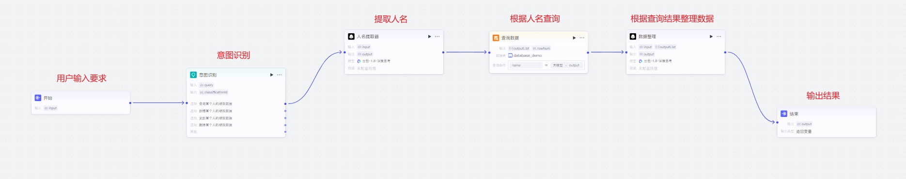

分步操作如下：

      1. 添加数据库查询节点 关联数据库 选择要查询的字段，如果选择performance_level，查询结果只有一个绩效等级 我想查询结果包含：工号，名字，绩效等级，所以选择三个 选择查询条件 数据表中的名字跟提取出来的人名一致，才是我想要的结果
1. 关联数据库
1. 选择要查询的字段，如果选择performance_level，查询结果只有一个绩效等级 我想查询结果包含：工号，名字，绩效等级，所以选择三个

我想查询结果包含：工号，名字，绩效等级，所以选择三个

1. 选择查询条件 数据表中的名字跟提取出来的人名一致，才是我想要的结果

数据表中的名字跟提取出来的人名一致，才是我想要的结果

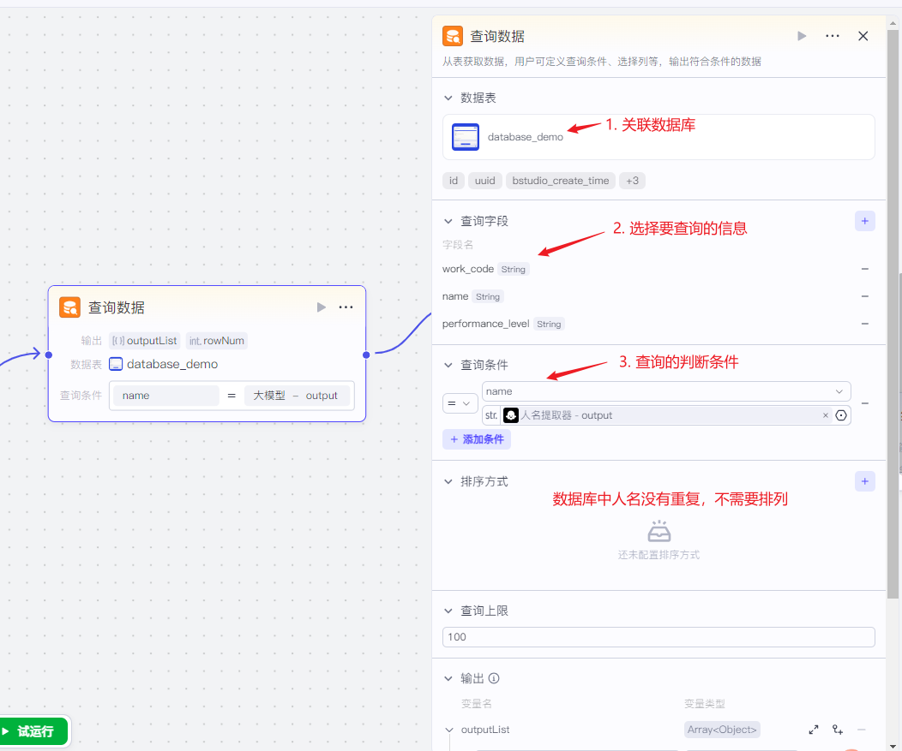

2. 添加大模型节点，负责整理查询之后的结果

> 系统提示词：

> 查询结果整理助手，能够根据用输入的问题和数据库中查询到的结果进行整合，并给到用户一个专业、得体的答复。

> 用户提示词：

> 用户输入：{{input}}

> 数据库查询结果：{{outputList}}

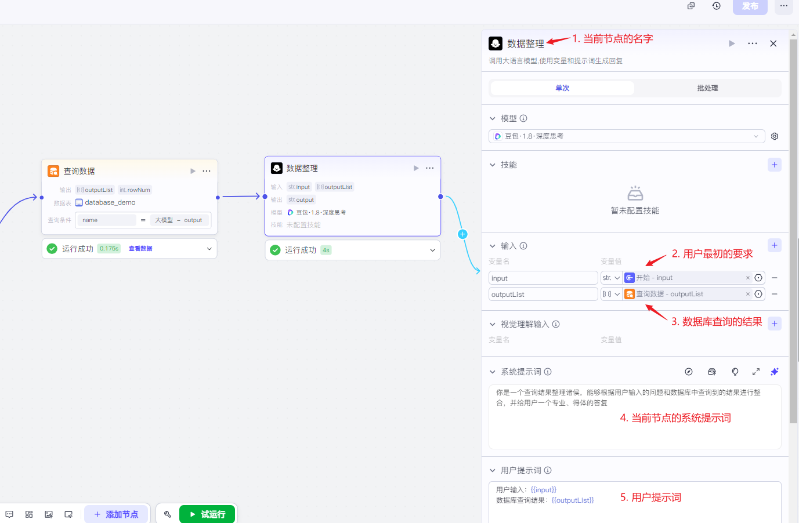

将剩余意图连接到结束节点后试运行

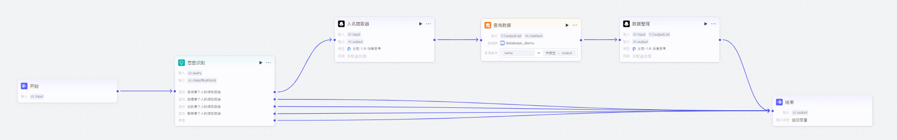

结果如下：

- 查询王大锤的绩效：表里有王大锤的数据，已查询
- 查询张三的绩效：表里没有张三的数据，未查询

测试通过

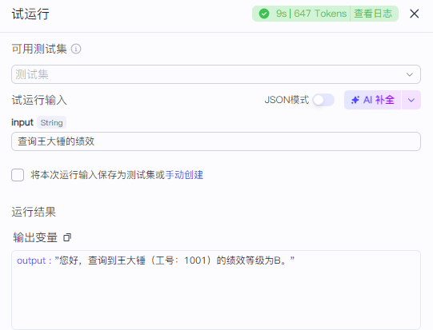

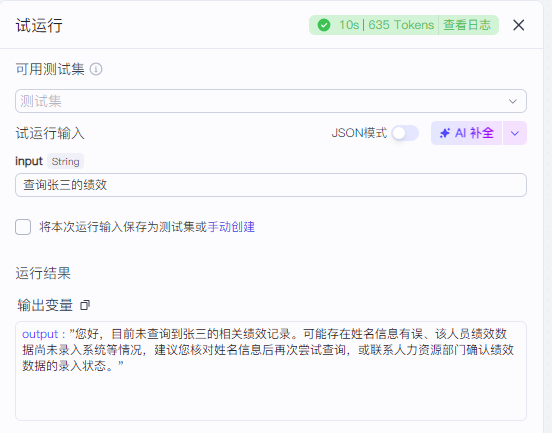

### 2.3.5 新增数据

新增数据的时候，需要用户输入工号、人名、绩效，而且我们要把这3个字段全部提取出来。

添加两个节点：

- 大模型节点：提取工号、人名、绩效
- 新增数据节点：把数据添加到数据库中。

整体流程如下

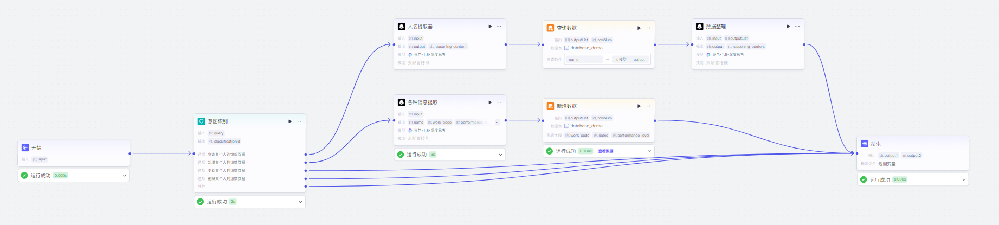

分步操作如下：

1. 添加大模型节点用来提取人的信息

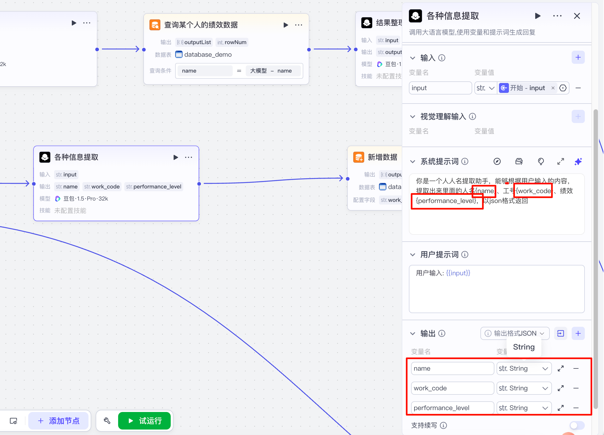

系统提示词：

```plain text
你是一个人人名提取助手，能够根据用户输入的内容，提取出来里面的人名{name}、工号{work_code}、绩效{performance_level}，以json格式返回
```

输出数据：

就是利用当前大模型节点提取出来的name，work_code，performance_level

2. 添加新增数据节点，把3个字段需要新增的值填入

其中输入数据关联前面大模型节点提取出来的三个值

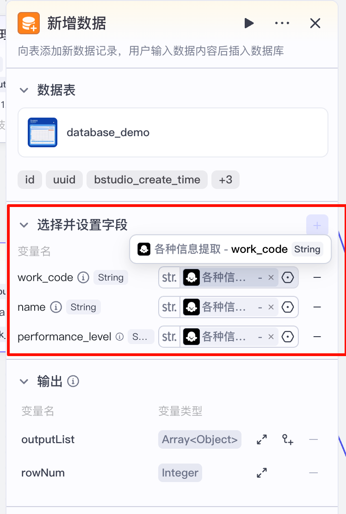

输入以下内容，试运行流水线：

```plain text
新增张三的绩效信息：姓名张三，工号1050，绩效S
```

去数据库中查看数据是否成功写入：

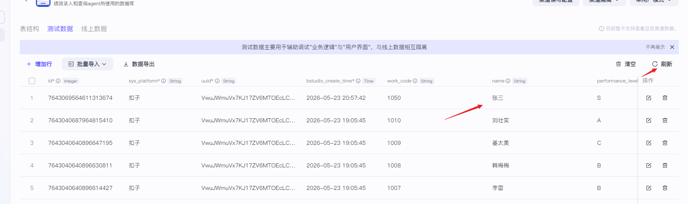

### 2.3.6 更新数据

更新数据，其实就是修改原有的数据，操作方式跟新增数据非常类似

区别在于更新数据需要先根据更新条件找到对应的数据，再更新这条数据中的内容。

添加两个节点：

- 大模型节点：提取工号、人名、绩效
- 更新数据节点：把数据库进行修改

整体流程如下：

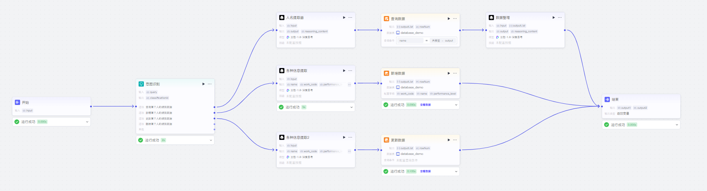

分步操作如下：

1. 添加大模型节点用来提取人的信息

直接复制"添加数据"后面的"大模型节点"。

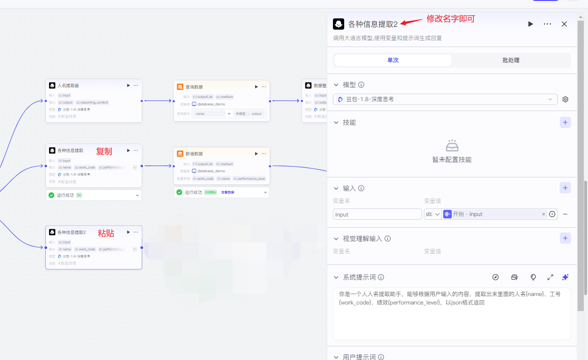

2. 添加更新数据节点

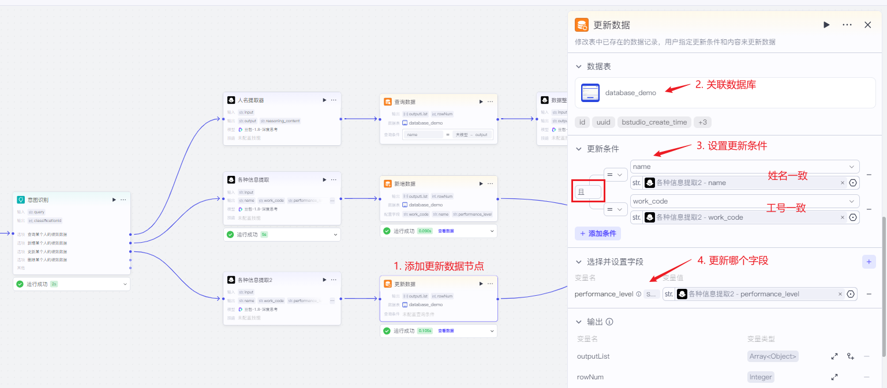

3. 试运行该工作流，输入提示词

```plain text
测试一：把张三的绩效修改为SS  // 修改失败
测试二：把工号为1050，行为张三的绩效修改为SS  //修改成功
```

查看数据库中的数据，可以看到第二个提示词修改成功，为什么呢？

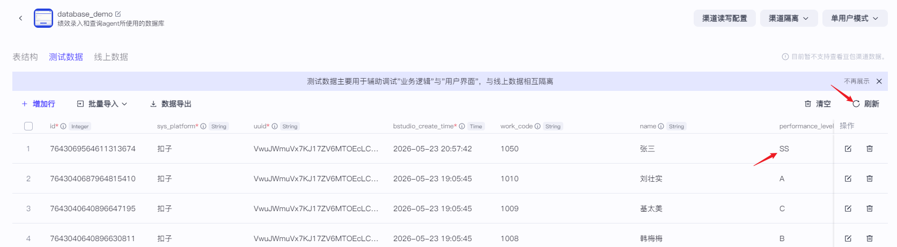

### 2.3.7 删除数据

删除数据只需要删除条件定位到这条数据，即可完成。 对于我们当前的业务场景，一般是工号+人名确定唯一一条数据，所以这里我们需要提取出来name和work_code两个字段，并形成过滤条件，

添加两个节点：

- 大模型节点：提取工号、人名
- 更新数据节点：把数据库进行修改

整体流程如下：

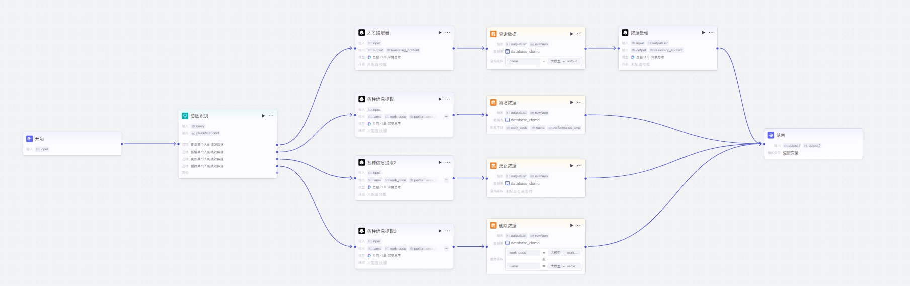

分步操作如下：

1. 添加大模型节点用来提取人的信息

直接复制"更新数据"后面的"大模型节点"。

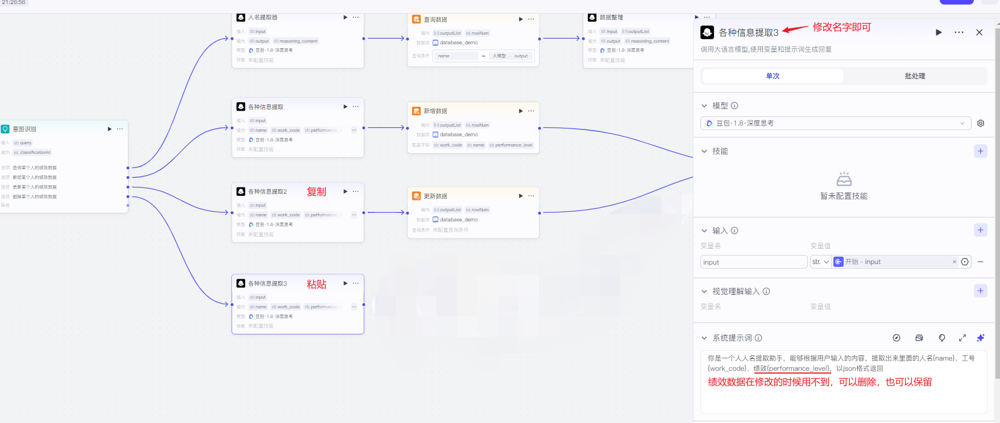

2. 添加更新数据节点

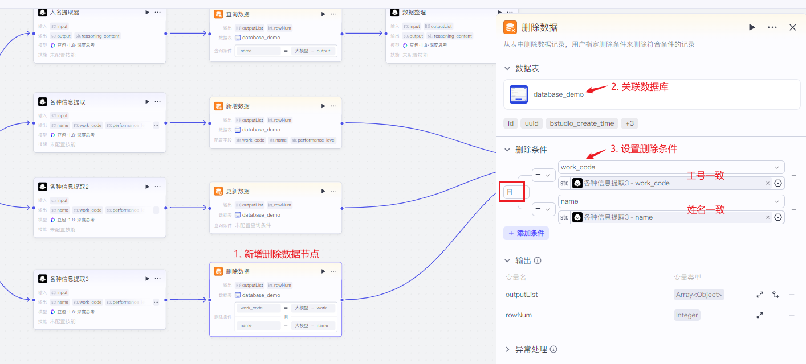

试运行该工作流，输入提示词

```plain text
删除张三的记录，工号1050
```

查看数据库，发现"张三"的数据已经被删除：

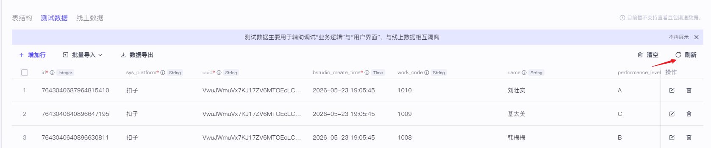

## 2.4 总结

数据库可以永久保存数据，在以后实际开发中我们会大量使用，现在我们是在Coze当中，通过图形化的方式用，在就业班，我们还会学习MySQL，通过SQL语句进行增删改查。
