# 5. 循环高级

> 来自《Coze的进阶使用》· [原文](https://baxsu7o100e.feishu.cn/wiki/KzUPwnjIsinaN7kB2JRcWuhrnZ7)

在之前的学习中我们发现，循环节点中还有两个小细节，我们没有学习：

- 循环的中间变量
- 无限循环

这两块较为复杂，所以我们放在最后学习。

下面，我们正式开始。

## 5.1 循环的中间变量

### 5.1.1 概念解释和应用场景

在刚刚，我们在操作循环的时候，每一次循环都是独立的。说白了就是把某件事情重复执行了N次而已。

但是在有的情况下，如果每一次循环要依赖前一次循环的结果，该如何操作呢？

此时，我们就可以把每一次的计算结果存入到临时变量当中

举例：

计算1 + 2 + 3 + 4 + 5的和

在计算的时候，我们可以一下子就把他们计算出来，但是也可以利用循环计算

计算过程如下：

1. 先定义临时变量temp，记录为0
2. 第一次循环：把1累加到temp当中，计算后，temp记录1
3. 第二次循环：把2累加到temp当中，计算后，temp记录3
4. 第三次循环：把3累加到temp当中，计算后，temp记录6
5. ...
6. 以此类推，得到最终结果15

这种计算方式，也是符合数学中的运算逻辑的，从左到右依次计算

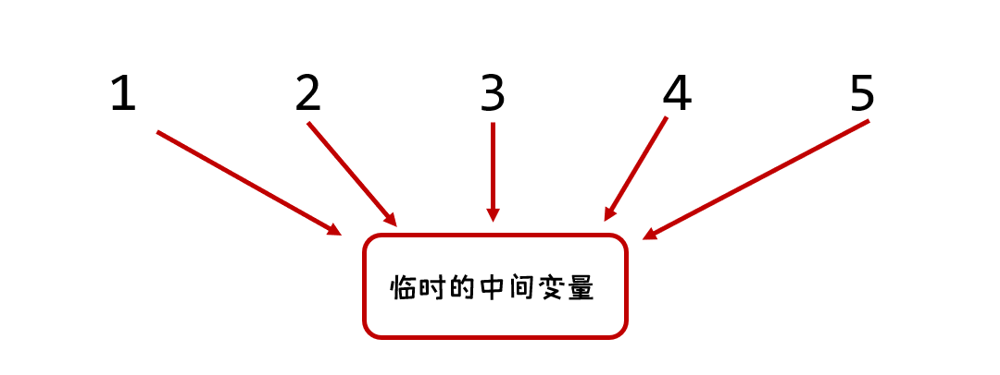

接下来，我们用工作流实现一下这个计算过程：

### 5.1.2 开始节点

因为是多个整数，变量类型选择：Array --- Integer。

类型含义：数据是放到一个数组里面的，数组里面每一个数据都是整数。

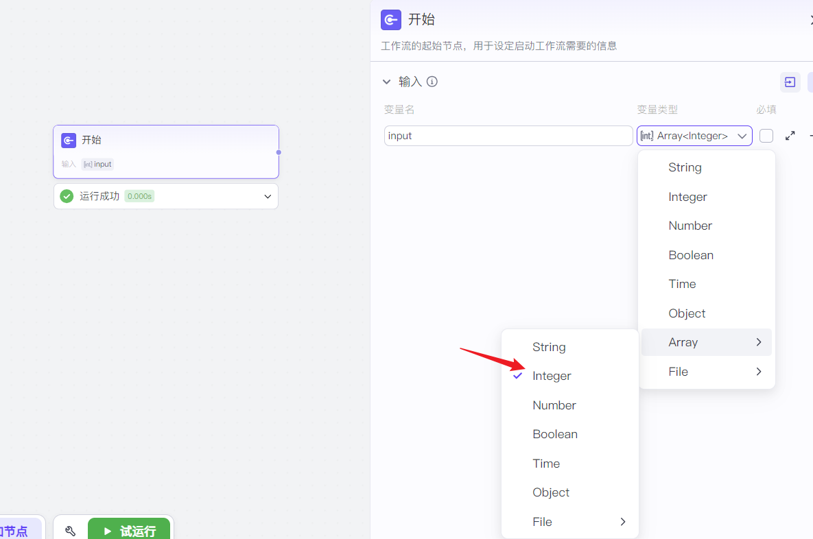

### 5.1.3 循环节点

- 循环设置：使用数组循环

> 解释：因为开始节点中是把多个数据放入到数组当中的，我们就要以数组方式进行循环

- 输入数据：关联开始节点中的数组
- 中间变量：整数，最初为0

> 解释：循环当中要累加1~5，那么在累加之初，中间变量记录的就是0

- 输出数据：关联中间变量

> 解释：循环结束之后，中间变量temp记录的值，就是累加的结果sum

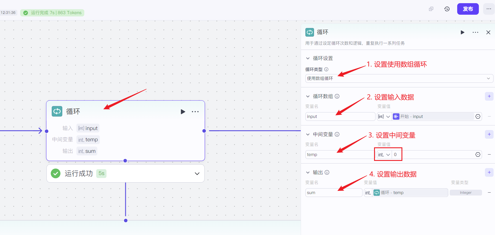

### 5.1.4 循环体

在循环体当中，我们要做的其实就是三件事：

- 获取到数组中的每一个数字[1，2，3，4，5]
- 把获取到的数字，累加到中间变量temp中
- 不断修改temp里面记录的值

其中，前两件事情，用大模型阶段完成，最后一件事情，用设置变量节点完成

#### 1. 添加大模型节点

大模型节点就是负责计算的

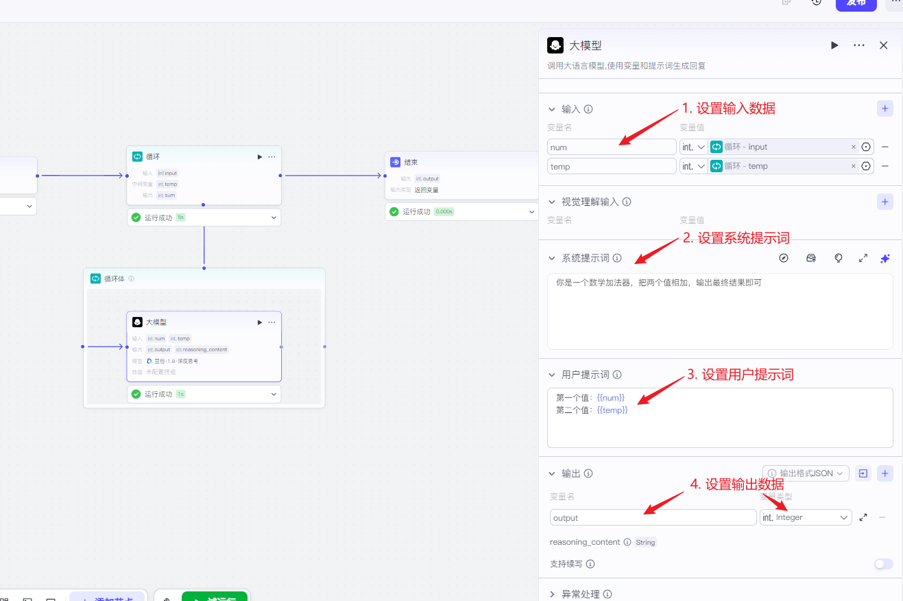

系统提示词：

```json
你是一个数学加法器，把两个值相加，输出最终结果即可
```

用户提示词：

```json
第一个值：{{num}}
第二个值：{{temp}}
```

#### 2. 添加设置变量节点

设置变量节点：负责修改中间变量的值

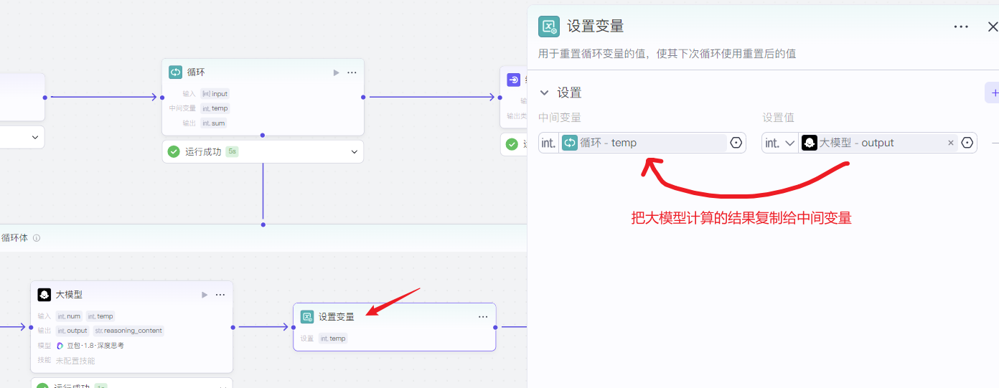

### 5.1.5 设置结束节点

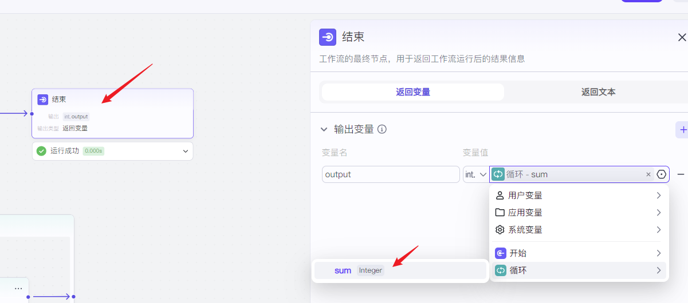

### 5.1.6 试运行

输入一组数据[1,2,3,4,5]，得到最终结果15

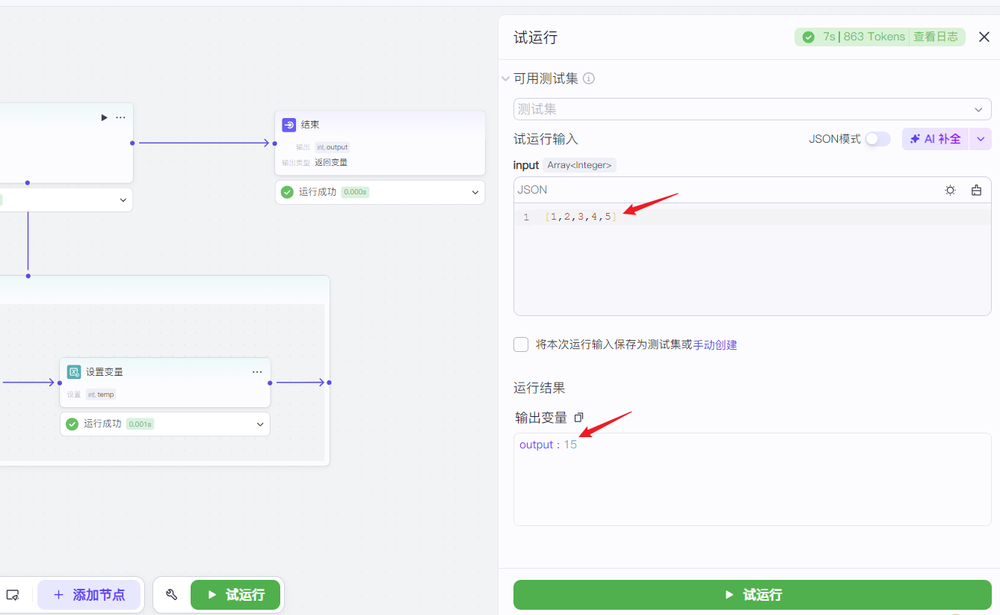

## 5.2 无限循环

### 5.2.1 概念解释和应用场景

字面意思：循环一直运行，永远停不下来。

实际上：我们不会真的一直运行，而是在符合条件的时候，让循环结束。

应用场景：不知道循环次数，也不是以数组的方式循环，就可以用无限循环。

举例：

利用AI生成简历的时候，需要用户输入以下信息：

- 姓名
- 年龄
- 学历
- 毕业院校
- 毕业时间
- 手机号
- 邮箱

但是，你不知道用户输入的数据是否完整，那么就需要利用循环进行校验。

- 如果数据不全，提示让用户继续输入
- 如果数据完整，循环结束

这就是一个无限循环的标准用法

### 5.2.2 无限循环案例

案例需求:

> 采集用户输入的访客信息, 保证数据完整之后再插入数据库中, 用户访客信息包含(访客名称, 访客日期, 访客手机号, 访客目标, 访客状态,访客备注等字段) , 其中(访客名称, 访客日期, 访客手机号, 访客目标) 是必填项

步骤:

#### 5.2.2.1 创建开始节点

主要负责收集用户第一次输入的数据

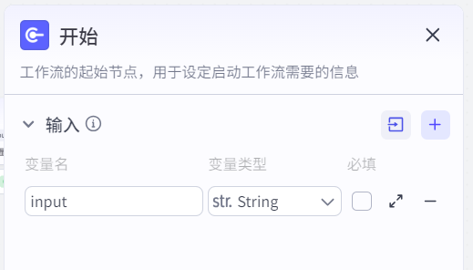

#### 5.2.2.2 循环解决数据收集问题

使用无限循环解决搜集数据的问题

概览:

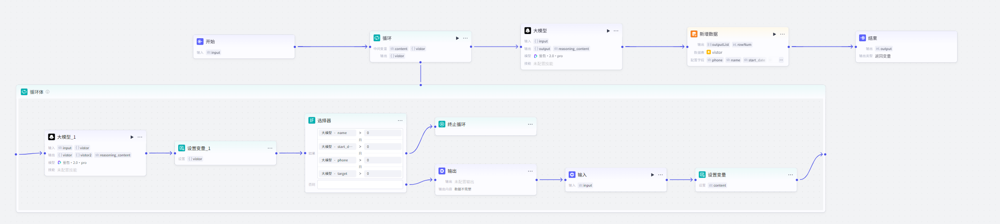

##### 5.2.2.2.1 创建循环节点

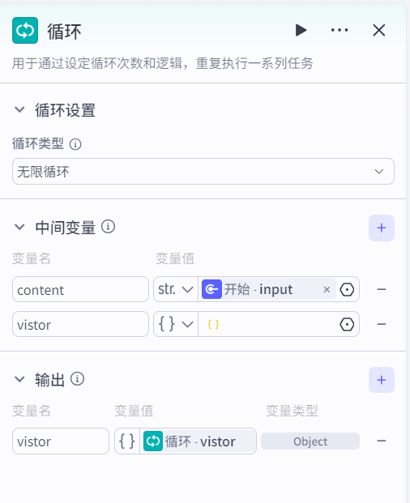

循环类型: 选择无限循环

中间变量:

```java
content:
接受用户输入的内容, 为何非常定义中间变量?
因为我们输入不是一层不变, 当数据不完整需要用户重新输入, 我们应该采用变量记录不断输入的内容
vistor:
存储我们搜集到的访客信息数据, 刚开始是对象类型, 没有任何数据, 后期不断往这个容器中填充数据
```

输出:

将vistor搜集好的数据交给下一个节点完成即可

##### 5.2.2.2.2 循环体节点

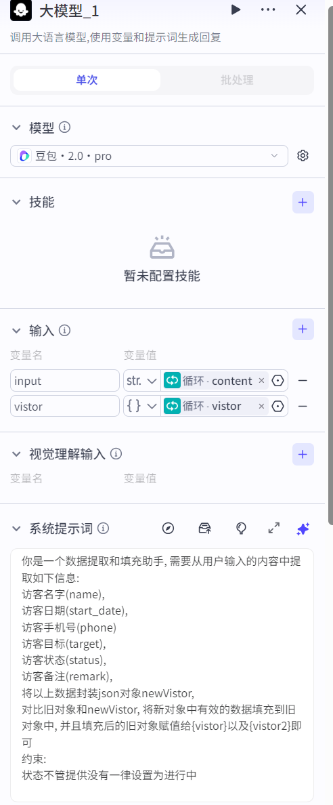

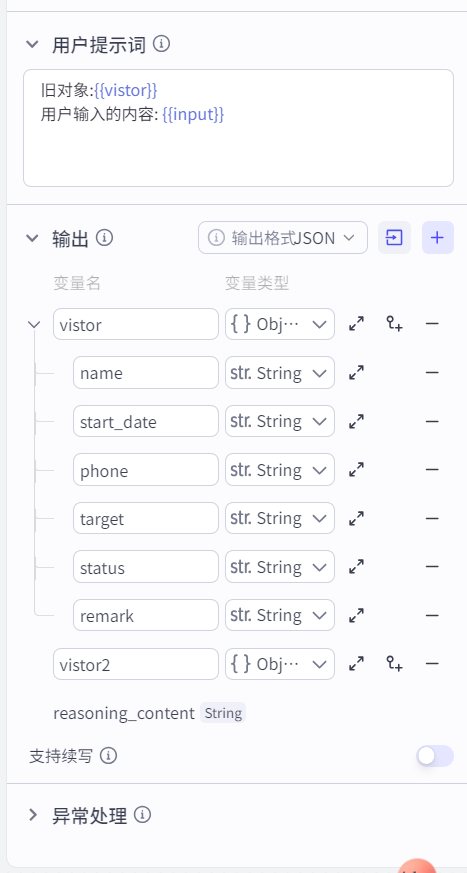

输入:

```java
Input: 用户新输入的内容
需要重新提取数据
Vistor: 接受中间变量用于存储搜集到的数据
将以前搜到的数据数据和新提取的数据整合在一起
```

系统提示词:

```java
你是一个数据提取和填充助手, 需要从用户输入的内容中提取如下信息:
访客名字(name),
访客日期(start_date),
访客手机号(phone)
访客目标(target),
访客状态(status),
访客备注(remark),
将以上数据封装json对象newVistor,
对比旧对象和newVistor, 将新对象中有效的数据填充到旧对象中, 并且填充后的旧对象赋值给{vistor}以及{vistor2}即可
约束:
状态不管提供没有一律设置为进行中
```

用户提示词:

```java
旧对象:{{vistor}}
用户输入的内容: {{input}}
```

输出:

```java
vistor:
需要配置访客的内部的属性, 因为后期的选择器节点需要拿到必要的数据检验是否完整, 但是coze的自身bug
无法将这个对象直接存储到中间变量中, 因为中间变量不能配置子选项, 所以, 我们需要在额外定义vistor2
为了设置给中间变量用

vistor2:
为了给中间变量设置值, 保证类型一致使用的
```

##### 5.2.2.2.3 定义设置变量节点

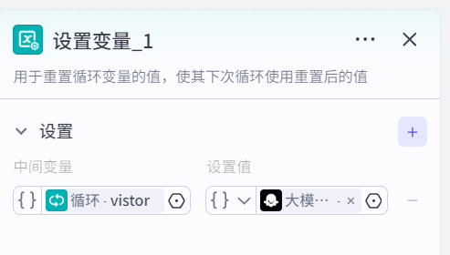

将大模型的结果存储到中间变量中

##### 5.2.2.2.4 定义选择器节点

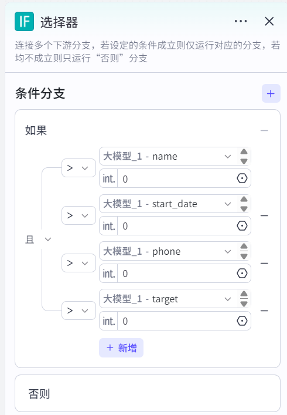

判断刚才搜集的数据是否完整, 如果完整结束循环


否则重新输入, 在重新输入之前需要输出提醒语句

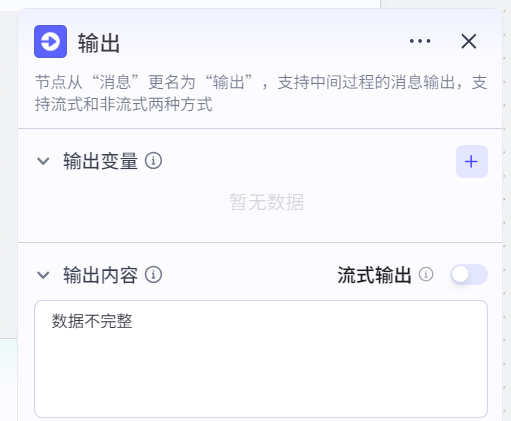

在重新输入

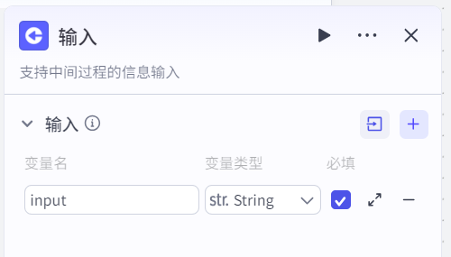

将重新输入的内容设置到中间变量中, 然后下一次循环就可以提供新输入内容中的内容了

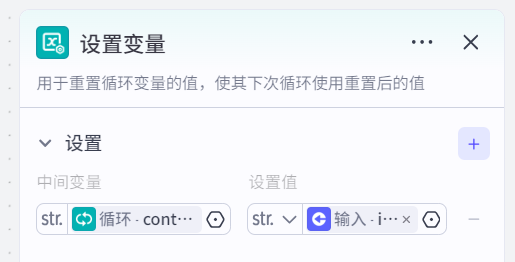

#### 5.2.2.3 解决存入数据问题

作用: 将数据的子选项显示出来, 因为插入节点时代码, 只能机器取出数据, 而且中间变量不能定义子选项, 所以必须取出子选项, 插入节点才能使用

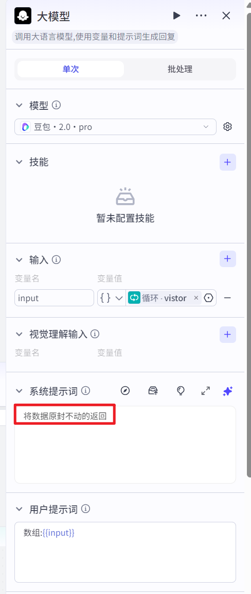

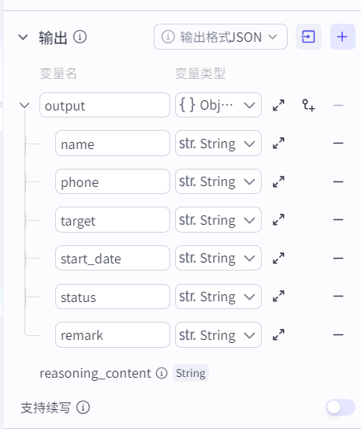

他的任务及其简单, 就是将对象原封不动返回, 只不过配置了子选项, 让数据库插入节点可以直接使用了!!!!!!!!!!!!!!!!!!!

#### 5.2.2.4 数据库插入节点

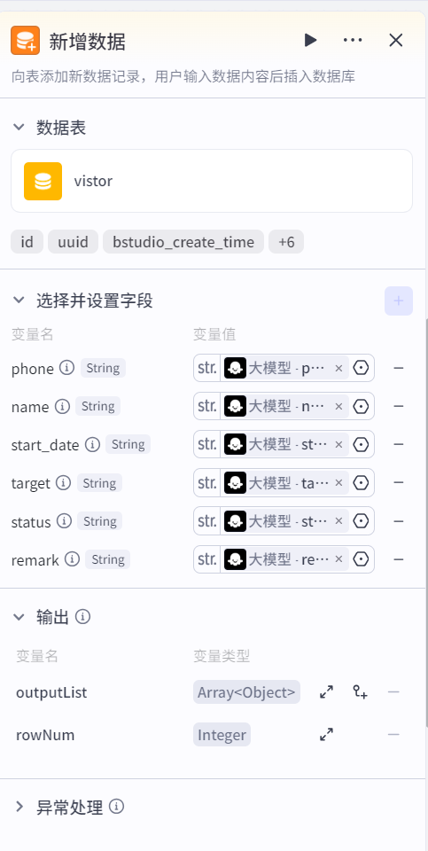

负责将整合后的数据, 插入到数据库中

#### 5.2.2.5 结束

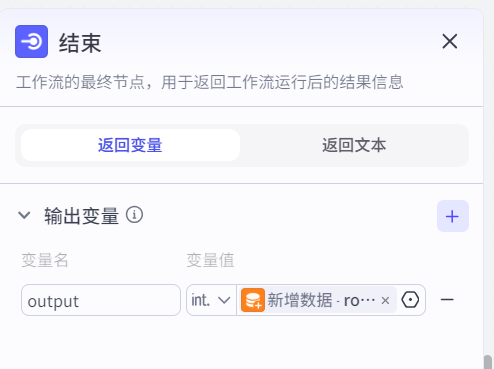
