# 项目二：面试录音分析

> 来自《项目实战》· [原文](https://baxsu7o100e.feishu.cn/wiki/ZjI1wNJKiiBzdlkjC8rci3DcnzU)

## 1. 项目介绍

学生上传录音文件，再将语音转成文字并分析面试情况，除了基于规则以外，也会基于面试宝典和互联网上的答案判断回答的结果是否准确，同时记录到真实的面试题题库中，最后生成面试评估报告。

完整流程如下图：

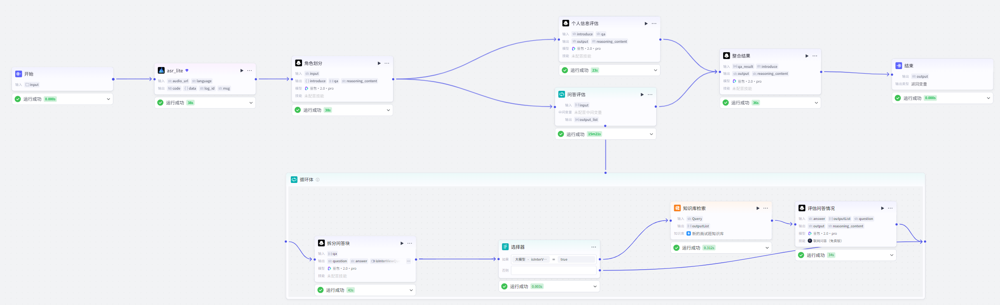

具体步骤如下：

输入：面试语音（Mp3、Wav等格式，不支持m4m）

执行流程：

1. 面试语音转文字：基于ASR技术将面试对话语音转为文字，为追求效果，我们这里选择使用大模型ASR插件
2. 角色划分和概要提取：基于语音转后的文字，通过大模型拆分面试官和应试者两个角色，将自我介绍、提问、回答进行提取，并总结面试问题粗略的分布。同时也判断如果不是面试对话录音，则进行拦截。
3. 面试表现评估：对自我介绍、提问、回答进行评估。面试题回答情况基于面试宝典 + 互联网答案综合判断，同时把面试题记录在数据库中，以便后续建设新的面试题库。
4. 报告内容生成：结合总结面试问题粗略的分布、自我介绍评估、面试问题回答评估的结果，拼接面试题文字原文，生成最终的报告。

输出：面试结果概要、面试表现评估、面试对话原文

## 2. 项目实现

#### 第一步: 创建开始节点上传录音

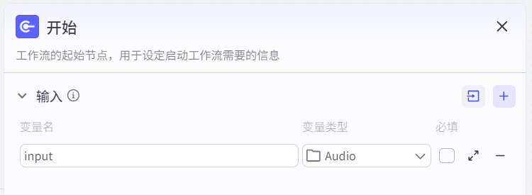

#### 第二步: 导入插件解析录音

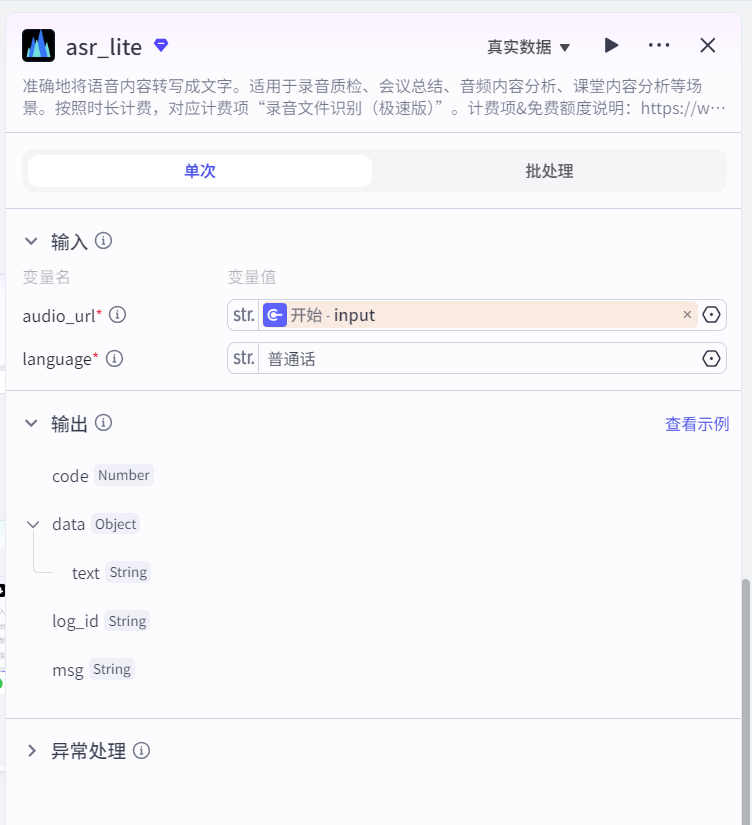

由于录音真的很耗积分, 所以我们这边将录音的结果直接存放到下面, 测试的可以节约积分

```java
{
"code": 0,
"data": {
"text": "讲啥呀那面试官你好啊你好听得到吗喂你好啊您叫那个沈凡超是吗是是是喂啊听不到吗啊可以你叫沈凡超是吗对对是的稍等我看一下你的简历啊你现在工作三年是吧对你现在是一个离职状态还是在职状态啊嗯还没完全离职海报完全离职啊是江苏的一家公司是吧是的然后你那个学历是在那个学信网上是可查的吗嗯可以查啊你说的是可以查呃大专是可以查的那然后大学的话是指名教网可以查啊您是大专可以查是吗你这个不是南京理工大学然后紫金学院吗对你是专科还是本科啊呃本科是他名叫我可以查啊我有点听不太清要不我们打电话吧好吧嗯应该差不多我觉得可能是我的这个麦克风有点问题啊我这边很听得不是很尊重哈那我尽量讲大声一点吧这你看这样可以吗这样吧我给你打电话吧好吧啊也行也行行啥玩意啊你就跟他说说什么不能骗他的骗他就烂了我不想骗他那你买都买了骗了呀这不能太骗太太过分吧自考本不就行了为啥非要是要一直强调民教的思考网还没闭眼呢来了来了来了安静呃你好听得清吧诶这回可以听清了啊好的好的啊我就想问一下你那个学历是呃在学习网上是可以查到啊你刚才说专科可以查到本科查不到什么意思本科也能查到但是本科啊就你你是专升本是吗嗯是的啊行然后你这边大概的一个期望薪资是多少啊十三到十八嗯十五吧十五是吧嗯好的然后跟您说一下我们是那个天阳红叶科技股份有限公司然后我们这个公司的话主要是做那种给银行做外包的然后一般的项目都是啊银行类的一个项目嗯不知道这种外包性质的话您那边接受过呃这个 hr 跟我说过了可以接受啊可以接受是吧嗯行那您那边先做一个自我介绍吧就是先介绍一下您现在所在的这个项目好吧呃行的行的行大致的一个情况啊好那我就说一下那个新商城的项目吧好好好嗯这个项目它是前后端奋力开发的然后前端的主要技术是 boeelement ui 等然后后端的话就是 spring boot springcloud 就是分布式嘛然后 fin 作为微服务之间的远程调用然后用到了就是 at 模式就是做分布式的事务管理然后吃旧层的话用的是 mybatis 还有 mybatis plus跟那个 mysql 进行那个数据交互嘛还用到 redis 做了一些缓存就是热点数据的缓存这样还用过还用过 es 就是进行了一些索引的快速搜索的倒排索引嘛这个这个不知道你们有没有了解过反正用了注册中心还有它分布式的那个注册中心还有配置中心的话我们是用的 nekos呃然后嗯服服那个服务和服务店的调用的话就是异步通信我们用的是卡夫卡还有 rabbit mq 但是嗯然后这卡卡夫卡的话用的比较多因为它性能比较强大嘛静态然后还有我们这里面还有一些那个页就是商品页面的静态化的存储用到的是 free mark 技术就是模板引擎吧free mark 对然后最后这些东西都会存储在本地服务器就是用的是 mio对象存储它没有用没有用阿里云的那个或者是腾讯云的存存储那我再介绍一下模块吧行呃嗯现在的话就是有两个端一个是系统系统的系统端还有一个是商户端系统端就是权限要大一点可以管像推广订单然后统计秒杀操作日志一些的之类的然后像商户的话就是就是商户本就是商户的操作嘛就比如说是呃商品的页面的嗯完善就是差不多就修改完善这样嘛啊还有一些他们自己的订单嗯然后对他们的对账也有一些管理我负责的功能就是我接下来我就讲一下我负责的功能我负责的功能有呃有几个我跟你讲一个先先一个一个来讲吧就是管理模块就是有一个商品管理模块它有一个商品上下架产品上下架的功能商品差价功能还有一个详细内容数据的展示还有数这些数据就是说通过一些技术导出呃上下架的话就是用到了卡夫卡做消息中间件然后异步通信就是跨服务调用数据内容导出的话用到的是 poi就是阿拉奇的那个就是导成 excel 表格把它导出来还有一个是推广的模块推广的模块有一个定时任务用到的是叉叉叫吧叉叉也要叫吧对行嗯嗯你们这个微服务分多少个服务啊就是一一个模块是一个服务吗不是不是不是嗯我想一下啊他是有两个端嗯具体有反正服务挺多的确实服务挺多的好的好的行这样吧我问你几个技术上的问题吧啊对了你这个前后端分离你们是前端也做后端也做吗呃我不做前端我只做后端啊你们项目组大概多少人呢九个人了九个人行那我问您一些嗯技术上的问题吧嗯buffer 的区别呃string 的话它是被final 修饰的然后它是不可变的嗯所以说你每次修改都会有一个新的对象然后他呃我先说 string buffer 吧 string buffer 的话它是有一个sykneze 锁的所以说线程比较安全这就是在多线程的情况下就是用嗯 string buffer 然后如果是在但是这样加 synalize 锁的话就会就是性能会有点问题然后所以说单线程的情况下就会有有一个 stream builder好然后嗯 mav 循环便利有哪些方式或者你之前用过哪些你什啥就是 map 循环循环 map 啊循环 map 啊对行或者你在开发中是怎样用的for 异曲你说是循环遍历吗对循环遍历啊啊 map 啊for 异曲或 for 循环嘛后循环是吧啊就是诶这不是不叫费用叫叫就叫叫啥来着让我想想啊哦还有用户那个 lambda 的那个是就是 lambda 里面可以也可以便利刚的话我们都是嗯循环它的 key 嘛就是点点 key key 错误嘛嗯嗯然后建一个 for 循环嘛嗯然后通过它的 key 取取到它的值嘛对吧这样对行它还有一个什么还有一个 entity entity 在的对吧它可以可以 get toget to 它的 key 还有 get value这种嗯还有就是嗯在你们这个那个现在这个项目中你们的 java 反射是怎么使用的自己有用到吗我的话好像还没有用到反射这个这个这个样子还没有用到反射嗯就是说如果说就是说也有呃看过别人用过就是说一般用在那个注解上面嘛就是说获取数注解上面的值啊会给重点上面的学对嗯哈希 map 和哈希 people 还有那个 concurrent hashmap 的区别是什么嗯哈希我就呃现在知道就是哈希 table 的话一就是呃 hashtable 和 current hashmap 是有点相似就是线程安全但是map 的话就是要他是好像是有一个他就是锁和哈希 table 的锁是不一样哈希特步现在已经high table 现在已经不太不太用了都是用康康的哈希 map 来做线程安全的这个嗯这个他他这个呃康博瑞达他现在的他的底层你了解吗数组加应该是数组加列表吧就 free in 中有那个就是 resource 注解和 outfier 注解对吧它都是做那个 bin 的注入嘛对对对这两者有什么区别呢嗯auto will 的话是通过那个类型注入的然后 resource 的话是通过名字注入的找不到名字的话他就会通过呃类型注入嗯类型是吧但如果说我就是想要那个 outline呃实现那种类目的去匹配内部的话他有什么其他的方法吗这个的话好像还没用过你跟我说一下 spring lb 和 ioc 吧啊行aop 是面向切片编程然后 ioc 的话是控制反转就是 spring 就是用到了很多 ioc 就是反转控制嘛就是它是一种设计思想它是本来是我们自己要 new 对象的然后它现在变成了就是把对象塞到容塞到一个容器里面那容器是一个大 mapmap 里面就是放我们需要的对象嘛就通过注入的方式把那个对象给它注入到那个 lt 容器里面然后 l lp 的话他是基于动态代理的就是代理的话就是可以增强本来方法的逻辑嘛那 lp 有在实际项目中应用吗用在过日志今天开发有用到那个 lp 吗就除了日志事务管理应该是有事务管理我记得还有事务管理事务管理还有全局异常全局对全局异常我们也用到这个全局异常的处理行然后问一下那个现成的那个生命周期先是几种状态一我记得是有五种就是先是最开始是 new然后但是但是 running 然后还有是个然后但是如果说如果说就是说如果说有什么锁啊之类的他可能就阻塞了阻塞就是 block它主要有几种就是新建然后还有一个就去然后运行阻塞死亡嗯这五种状态嗯线程池有用过吗新人师也用过嗯他有几个核心的参数能说一下吧呃有七个核心的参数然后第一个的话是核心线人数第二个的话是存活时间第三个是存活时间的单位第四个的话是啊少说一个第二个的话是最大第二个是最大线程数最大线程数啊就是啊线程池最大线程数然后第三个的话是存货时间第四个的是存活时间的单位第五个的话是工作队列第六个的话是线程工厂还有一个是拒绝策略就最后一个第七个嗯啊你能说一下它线程池的一个执行的一个顺序吗它是怎样执行的先是呃有个任务就是任务先走到核心线程看核心线程有没有买核心线程核心线程没买就让核心线程干核心线程买了就塞到队列里面然后如果队列买了队列买了就让临时线程干临时线程买了就拒绝就有拒绝那个就触发那个拒绝策略了嘛拒绝策略是吧对这个拒绝策略我们可以自定义吗呃可以你们之前有写过这种拒绝策略吗没有写过都是用的别人的好的然后问一下那个check list 和和 lock 的区别首先 lock 的话肯定就是要有个那个 lock 的对象他才能 lock的话就不需要这个然后就是 synalize 的底层好像也和 lock 的有点不一样 synonize 的底层好像是有就是每个对象有个监视器呃每有每个对象都有个监视器对象它加 synalize 的就是为了就是让每个线程去抢这个呃监视器对象行我看你用用到那个卡不卡吧对吧是的是那你怎么保保证这个消息队列如何保证这个啊这个消息不丢失啊这个让我想一下啊应该是备份一下吧可能就是那种分我记得卡夫卡里面是有分片的分片的然后呢就是说一个分片就哎呀是不是在分片我忘记了就反正是备份它就是他可以把呃就记得这就反正我是当时记得是这样呃一个就比方说一个一个比呃哎我是怎么描述呢就比如说呃比方说有三个分片然后一分片放在一二二分片放在一三三方三分片放到二三然后比方说一分片一分片一分片没用了然后那个二三分配还是呃就是还是保留就是本来所有的数据还有一句话好像还有个限制阻塞时间吧我记得就是不要让他不限不给他限制阻塞时间就是说如果缓冲去买的话就让生产者一直处于阻塞状态好啊嘿啊就是说如果我一条 sql对吧我可能不知道不知道生产环境可能会很有很慢嗯基本上啊如果你想优化的话你从哪几个方面去进行优化呃加缩影这是最就是最快的加缩影然后你就加你就给这个呃 sql 的数据库给它就呃分几个服务器嘛那就可以那那或者是说给这个 sql 的这个服务器让它变变硬件配置高一点还有别的吗优化一下就这个表的结构就是也能是能优化一下哥哥你又怎么听话字段比方说字段长度的控制呀就是说有些字段可能就不需要这么长你要你要非得给他设这么长然后他可能就搜得就比较慢一些还有的话你 sql 就是 sql 搜索慢还有个原因就是说嗯你当时呃索引没用上就虽然加了索引但是索引没用上也会这样的情况啊那有哪些情况下索引恢复生效呢拼就首先最最常用的就是拼百分号就是你在前面拼一个在后面拼一个然后他就没用了然后还有的话就是字符串就是说不同类型的比较比就是说字符串和数字比的话它也就呃没用了还有你要用这个我想想啊你要用这个索引去你要用这个字段去做计算的话它也会失效还有吗我想一下啊我记得还有一个正则表达式吧应该是还有个好像是正则表达式它就不会走索引嗯嗯可以然后嗯如果说我要给这个表加索引应该给哪些哪些字段加索引呢对吧我需要考虑哪些情况呢什么样的字段需要加索引什么样的字段不需要加索引最肯定是就是最常用到你最常用那个字段去搜就是说要去加索引嘛一般就是说来说是名称之类sql sql 这方面有一个年龄的字段嗯我这个适合加索引吗年龄的字段不太适合加索引我觉得不是不是年龄啊是那个性别的字段不适合家族不合不适合家族因为他只有两他只有两种情况年龄呃就是性别的话你这不是就一一共就是男或者女嘛嗯然后你去加了就是没有意义啊你就就搜就还是卖呀好了都了解哪些这个我知道的首先嗯开机的话我不知道但是关机的啊关机的话就恰当然后什么 docker docker 里面也有一些命令我也知道就有一些 wrong start ps 然后 log 这样呃还有一项编辑一些文件的话就需要用到 vi 命令然后还有什么 cd这个太多了感觉但是就是普通的一般我就是只是普通的这样用用也不是用的特别印尼也没有用过特别长经常用的都有哪些就比如说 cd 啊 vi 然后你进了那个 vi 就要按一下然后冒号 wq 然后保存退出这样或者是或者是 ls 就是目录查看就是看一下你们有啥文件之类的还有还有的话就是说那个 id我我应该用什么命令获获取什么java 进程的 idjava 进程的 id对呃我记得好像是有个度跟跟端口有关但是反正是确实有里面有个什么 ll 然后把 id 传进去就好了这个这个这个没咋用因为 linux 也不是就是我主要负责的这个就是用是用过但是不是很清晰这个好然后我看您用了定时任务是吧嗯就如果说呃那肯定是要集群部署的嘛那项目肯定要部署到多台服务器上嘛对吧对对那如那肯定会出现就是一个定时任务可能会被多次执行的这样的一个问题嗯你那边是什么解决的呃比如说像嗯就是说还是看什么任务就是说如果说是呃你不许不要让他不让他用不要让他要多次执行的话就我们会用叉叉叉叉 l job就是那个分布式的任务调度平台嘛然后就是自定义一些就是自定义你想什么时候呃什么时候呃给他一个我想想怎么说就是什么时候让他执行你就去他那个网站然后给他改一下改一下那个空表达式一般的话就是采用的是轮询的策略然后就是每一台服务器这样用一下用一下用一下用一下啊买数据库用是买买 sql 是吧对 mysql啊能说一下它的那个四种隔离级别吗是读已提交读未提交然后不可重复读还有可串行化那个吗我记得好像啊是啊他默认的默认的管理级别是哪个默认的是不可重复读就是 mysql 的话是默认的不可重复度但是好像听说 oracle 什么的是第二种注意提交是吧对对对非关锁和乐观锁有什么区别啊嗯悲观锁的话就是他默认就是觉得别人会来改他的数据然后他会把那个数据给他锁住然后乐观锁的话就是默认不会改他的数据然后他会去呃表里面就是修改前会查一下他这个呃这个字段的值然后修改后再查一下这个这个字段的值那乐观狗会产生什么问题呢嗯性能这种情况性能开销会比较大就是它因为它一直会去就是说如果说如果说你没没改成功的话我不是得一直去可能就是得一直去改嘛一直去改的话就性能就开销就大了就是他他有这种情况就是他有一个 aba 的一个问题啊就是说我之前之前可能只是只是 a 对吧嗯那我改成 b 了今天改成 b 完我又改成又改回了 a那这种论文索他认为数据是正常的那这种情况他是怎怎么解决的呀这个不太了解了就这个就不太了解了你们那边的一个就是整个的一个开发流程是怎样的呀就是从从需求啊然后到开发这套测试是怎样的一个过程啊我就记得一直要开会你们那边有需求分析师吗有没有没有问了然后哦对了还有一个还有一个就是啊因为你们这个是微服务嘛是吧对那你们那边是怎么实现那个分布式事务一致性的用的 sita 的 at 模式就是说但是那个嗯我就了解这个其他模式我我是就是只是知道然后常用的我们那边常用的就是 data 的 at 模式它比较简单嘛就你加个注节然后就反正很嗯配置配配置比较简单我记得就是加个注解然后差就是是 global transaction然后你没没听太清是什么模式at 模式at 模式对就是要在表里面加呃 undo log 的那个表就是可能我估计不是很了解这个点你觉得你这嗯你对哪一块比较对哪一块技能比较比较了解啊比较擅长能说说吗那肯定就是加法 se 啊啊就是加了基础嘛加了基础然后就你说的是你说的比比比如说是有哪些技术呢嗯嗯就 spring mac 啊就 spring boot 啊这些都 spring boot 吧块比较比较更更更加就是能说得更加好一些的视频部的现在用的多嘛然后比较简单然后可能就知道多一些嗯他不都是都是配的嘛是吧对先赶紧陪着行啊我这边没什么要问的了你看你那边还有什么要问的吗就是工作时间然后什么福利待遇之类的可以就是问一下吧嗯因为我们这边嗯因为我也不不太清楚你来我们这边会进哪个哪个银行这有可能大部分可能会进那个大很大可能可能会进那个中信银行嗯但中信银行我们这边也也有好几个项目然后像我们现在这个项目的话就我现在单子这个项目的话它是呃周六周天是不怎么加班的嗯啊然后平时的话平时的话可能加一一两天可能晚上会有有有有点事可能会加加一些班嗯平时的话就是比方说一个月或者是这个样子嘛一个月或者一周还是一周嗯我们也都是分班嗯就可能一周有那么一一两天你可能需要加加那么一个小时行行行等等到一个半小时这样呃还有的话就是可你面完的话还是要去我嗯 hr 跟我说还要去航试是吧就是说对啊啊就是我们这边这边公司这边过了然后如果是进行里的话还需要进嗯啊银行还需要进行一个面试嗯还有就是工作地点呃你不是说是好几点的话我们我们现在是在那个朝阳区然后青天路这边都要填上就是固定的工作地点不会就是说你刚才说是不同的银行吧应该是不会在不同银行转正好去 hr 推推给我们这的应该就是中信银行啊行行反正就在朝阳区这边还有别的吗那应该没有了行然后问一下就是你那个新知十五 k 的话是呃上下可可可可就是上下标准可接受吗还会可以调它还会变动吗这个最后也得看 hr 那边我看您这个简历上写的是十三到十八是吧是就是呃如果说是十三十四这种你接受吗嗯肯定是要十五号的呀行这个那我这边就跟那个 hr 帮我报十五吧嗯然后您这个如果说是你大概离职需要多长时间呢你那边二十号左右吧二十号左右我可以就是说完全离职这个状态啊二十号左右行好的行那就没别的了好那我这边的话就把这个面试的那个结果然后会跟那个 hr 去去去去说然后他那边会联系你嗯行啊对啊对还有一个问题就是呃您这边面试过的话我那边航视台那边会就难度差不多有多少呢嗯差不多都都都差不多啊行行行啊啊行所以说如果说可以的话后面的话还得准备准备再嗯行嗯嗯好嘞那先这样好不是他这个人比较呆逼"
```

```java
{
"introduce": {
"education": "专升本，专科学信网可查，本科学信网可查，毕业于南京理工大学紫金学院",
"originalCompanyLocation": "江苏",
"workYears": "3年",
"expectedSalary": "期望薪资15K/月，最低接受15K",
"age": "",
"skilledFields": "擅长JavaSE、Spring Boot等后端技术，熟悉Spring Cloud、Feign、Seata AT模式、MyBatis、MyBatis Plus、MySQL、Redis、ES、Nacos、Kafka、RabbitMQ、FreeMarker、MinIO、XXL-JOB等技术栈",
"city": "",
"recentProjectIntro": "近期负责新商城微服务项目后端开发，该项目为前后端分离架构，分为系统端、商户端两个端口，系统端负责推广、订单、统计、秒杀、操作日志等管理，商户端负责商品信息维护、订单管理、对账管理等。本人负责商品管理模块（商品上下架、数据导出等）、推广模块（定时任务）的开发工作",
"acceptOutsourcing": "接受银行类外包项目",
"jobStatus": "未完全离职，预计当月20号左右可完全离职",
"name": "沈凡超"
},
"qa": [
{
"answer": "应试者:是是是",
"question": "面试官:您叫那个沈凡超是吗？"
},
{
"answer": "应试者:对对是的",
"question": "面试官:你叫沈凡超是吗？"
},
{
"answer": "应试者:对",
"question": "面试官:你现在工作三年是吧？"
},
{
"answer": "应试者:还没完全离职",
"question": "面试官:你现在是一个离职状态还是在职状态啊？"
},
{
"answer": "应试者:是的",
"question": "面试官:是江苏的一家公司是吧？"
},
{
"answer": "应试者:嗯可以查，大专是可以查的，然后大学的话是指名教网可以查",
"question": "面试官:你那个学历是在那个学信网上是可查的吗？"
},
{
"answer": "应试者:对",
"question": "面试官:您是大专可以查是吗？你这个不是南京理工大学然后紫金学院吗？"
},
{
"answer": "应试者:呃本科是他名教网可以查",
"question": "面试官:你是专科还是本科啊？"
```

#### 第三步: 使用大模型完成角色划分

输入:

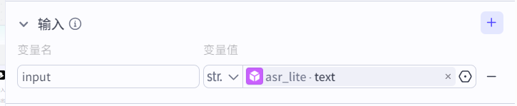

系统提示词:

```java
你是一个AI应用开发面试内容总结助手，专门负责处理AI应用开发工程师（技术栈包含Java、Python及Agent智能体开发）的面试内容的总结，你能够根据给定的输入对话的进行内容的提取，你需要做的事情如下：

### 任务一:  将面试者自我介绍的部分提取出来, 封装成json对象, 其中自我介绍包含了,  个人信息(名字, 年龄, 所在城市, ...) 等信息,  将封装好的对象赋值给 {introduce}

### 任务二: 将面试的多组问答内容提取出来, 如果是问题需要在问题前面拼接"面试官:", 回答问题的需要前面拼接"应试者:",然后在将拼接后的问答块封装json对象, 然后多个问答对象封装json数组赋值给 {qa}

### 约束:
1. 只需要解析原文即可, 禁止发散扩展
2. 如果提问没有答案, 则答案使用"" 替代
```

用户提示词:

```java
输入对话:{{input}}
```

输出:

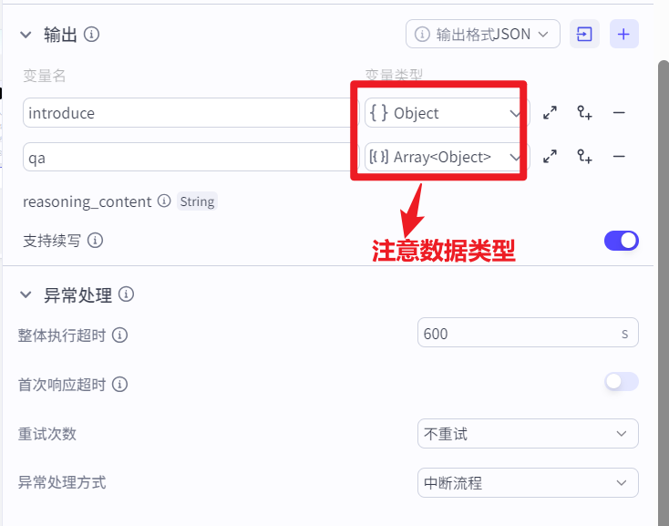

拆分的也比较耗费积分和时间, 所以将拆分后的问答以及个人介绍也附送可以节约积分

```java
{
"introduce": {
"年龄": "24岁",
"工作经验": "三年，参与过四个项目开发，掌握企业开发常用技能，业余会阅读源码以便快速定位解决开发问题",
"名字": "王翔",
"专业": "软件工程专业",
"所在地": "河南"
},
"qa": [
{
"answer": "应试者:诶面试官你好，我叫王翔，今年二十四岁，来自河南，之前所学专业是软件工程专业，目前有三年工作经验，着手参与过四个项目的开发，期间也掌握一些企业开发中常用的技能，平时工作时间之外也会去读一些源码，方便在公司开发中能够快速定位并解决开发中遇到的一些问题。",
"question": "面试官:你先做一下自我介绍好吧"
},
{
"answer": "应试者:嗯对的",
"question": "面试官:你是二零二零年毕业是吧"
},
{
```

```java
{
"introduce": {
"姓名": "沈凡超",
"工作年限": "三年",
"项目经历": "参与新商城微服务项目开发，该项目前后端分离，后端技术栈包含Spring Boot、Spring Cloud、Feign、Seata AT模式、MyBatis、MyBatis Plus、MySQL、Redis、ES、Nacos、Kafka、RabbitMQ、FreeMarker、MinIO等；项目分为系统端和商户端，个人负责商品管理模块（商品上下架、数据导出等）、推广模块相关功能开发",
"当前状态": "尚未完全离职，预计20号左右可完全离职",
"学历": "专升本，专科学信网可查，本科学信网可查",
"所在地": "江苏",
"期望薪资": "15K，可接受范围13-18K"
},
"qa": [
{
"answer": "应试者:对",
"question": "面试官:你现在工作三年是吧"
},
{
"answer": "应试者:还没完全离职",
"question": "面试官:你现在是一个离职状态还是在职状态啊"
},
{
"answer": "应试者:是的",
"question": "面试官:是江苏的一家公司是吧"
},
{
"answer": "应试者:大专可以查，本科也能查到，是专升本",
"question": "面试官:你那个学历是在那个学信网上是可查的吗"
},
{
"answer": "应试者:十五，可接受范围13到18",
"question": "面试官:你这边大概的一个期望薪资是多少啊"
},
{
"answer": "应试者:HR跟我说过了，可以接受",
"question": "面试官:我们是做银行外包的，这种外包性质的话您那边接受吗"
},
{
"answer": "应试者:这个项目它是前后端分离开发的，前端的主要技术是Vue、element ui等，后端的话就是Spring Boot、SpringCloud，用Feign作为微服务之间的远程调用，用到Seata的AT模式做分布式的事务管理。持久层的话用的是MyBatis还有MyBatis Plus跟MySQL进行数据交互，用到Redis做热点数据的缓存，还用过ES进行索引快速搜索。注册中心和配置中心我们用的是Nacos，服务间的异步通信用的是Kafka还有RabbitMQ，Kafka用的比较多因为性能比较强。商品页面的静态化存储用到的是FreeMarker模板引擎，最后这些东西都会存储在MinIO对象存储，没有用阿里云或者腾讯云的存储。项目现在有两个端，一个是系统端还有一个是商户端，系统端权限更大，可以管推广、订单、统计、秒杀、操作日志之类的；商户端就是商户自身的操作，比如商品页面的修改完善、自身订单管理、对账管理。我负责的功能，首先是商品管理模块，有商品上下架、详细内容数据展示、数据导出的功能，上下架用到了Kafka做消息中间件异步通信跨服务调用，数据导出用到的是阿里的POI导成Excel表格；还有推广模块，有定时任务用到的是XXL-JOB。",
```

#### 第四步: 个人介绍评估

输入:

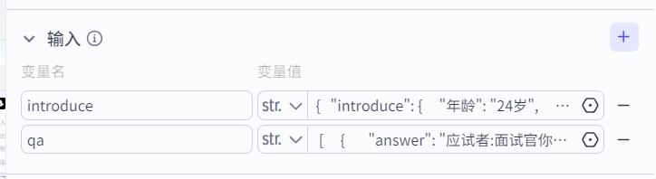

系统提示词:

```java
你是一名资深的AI智能应用开发工程师面试官，专注于考察候选人在 Java 后端、Python AI 服务及 Agent（智能体）开发领域的综合能力。
请基于以下规则，对用户的自我介绍和项目介绍进行严格评估：
1. 基础信息完整性：自我介绍必须包含姓名、学历、工作经历概览以及核心项目经验，不可有缺失。
2. 工作履历与角色定位：工作经历的介绍需重点阐述负责的业务模块、担任的角色（如核心开发、架构设计等），并突出在“Java+Python”混合架构下的协同开发能力或工程化落地能力。篇幅需长短适中，逻辑清晰。
```

用户提示词:

```java
个人介绍:{{introduce}}
项目问答: {{qa}}
```

示例:

```java
自我介绍评估结果
一、存在的违规问题
1. 基础信息缺失
自我介绍未明确说明学历层次（如本科 / 专科），同时核心项目经验仅提及项目名称，无核心贡献、技术价值相关内容，不符合基础信息完整性要求。
2. 工作履历角色定位模糊
工作经历仅说明供职过两家公司、涉及的业务方向，未明确阐述在各公司负责的具体业务模块、担任的角色（如核心开发 / 模块负责人等），也未体现「Java+Python」混合架构下的协同开发或工程化落地能力。
3. 技能描述为单纯名词堆砌
介绍技术栈时仅罗列技术名称，未结合具体场景说明技术应用深度。
4. 项目介绍无完整逻辑
仅零散提及 hugo 项目的延时队列实现细节，其余 3 个项目无背景、个人贡献、技术难点的完整说明，也未优先展示大模型应用、Agent、RAG 类高价值项目，无法体现技术能力。
5. 存在空泛软素质描述
主动提及主观软素质表述，无对应事实支撑。
二、改进建议
补充基础信息：明确说明学历层次，核心项目经验先总述 3 个最有价值的项目方向，突出和岗位匹配的技术点。
优化工作履历描述：每家公司明确说明「负责的核心业务模块 + 担任的角色 + 核心技术产出」，如果有 Java 后端对接 Python AI 服务、混合架构落地的经验要重点突出。
优化技能表述：将技术栈和具体场景绑定，例如可以表述为「基于 Spring Boot + Spring Cloud 搭建医疗业务微服务，用 Redis ZSet 实现待支付订单延时队列，峰值支撑 1000 + 订单 / 秒的处理效率」，避免单纯罗列技术名词。
结构化梳理项目：优先挑选 3 个和目标岗位（Java 后端、AI 服务、Agent 开发）相关度最高的项目，每个项目按照「业务背景→我的核心贡献→解决的技术难点→落地成果」的逻辑介绍，单项目描述控制在 1 分钟内，重点突出技术决策和价值。
删除空泛软素质表述：所有能力都通过具体项目事实体现，比如要说明学习能力强，可以举例「之前为了优化延时队列性能，一周内掌握 RocketMQ 核心特性，替换原有 Redis 实现后任务处理稳定性提升 40%」，避免主观自我评价。
```

#### 第五步: 问答评估

这个稍微复杂一点, 需要循环完成, 整体的逻辑如下:

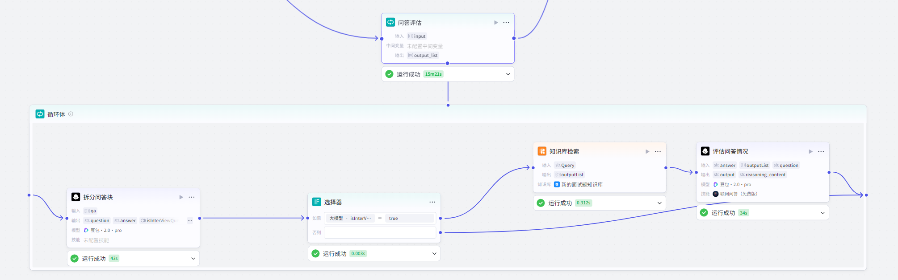

循环节点的设置:

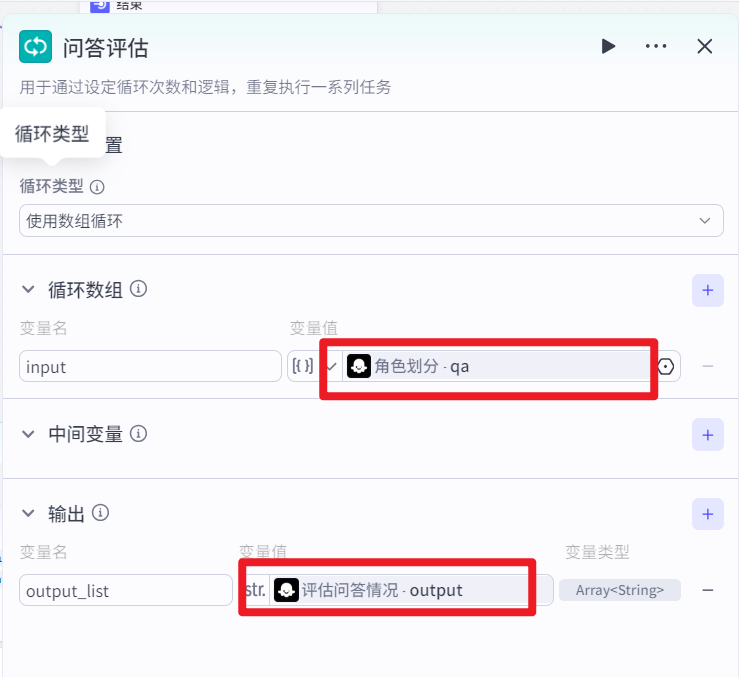

循环体节点的设置:

1. 大模型节点拆分问答:

输入:

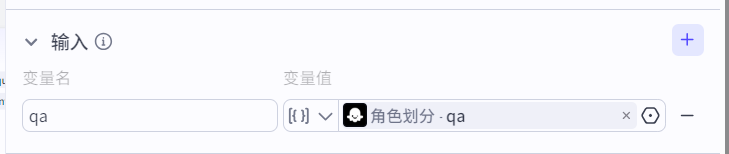

系统提示词:

```java
你需要从问答对象取出answer和question, 如果问题是问的基本信息的或者个人信息或者项目相关问题的话, 设置{isInterViewQuestion}为false,  否则设置为true, 将拆分出来的answer设置给{answer} , 将拆分出来的question设置给{question}
```

用户提示词:

```java
问答对象:{{qa}}
```

输出:

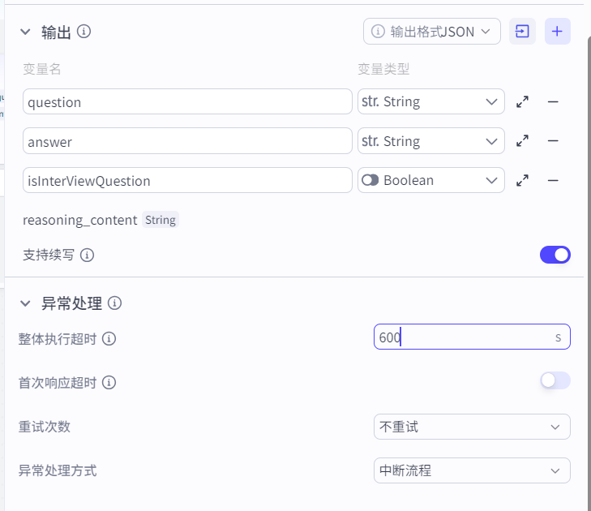

2. 选择器节点判断是否是面试题

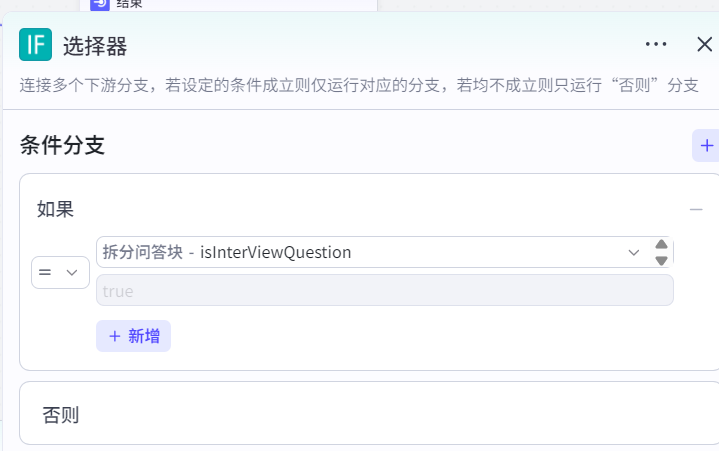

3. 设置知识库搜索节点

需要设置知识库

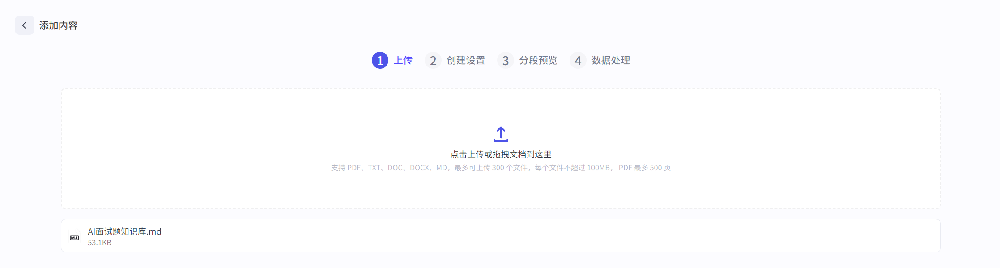

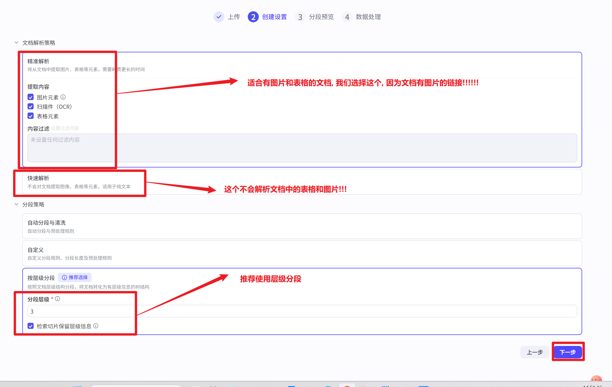

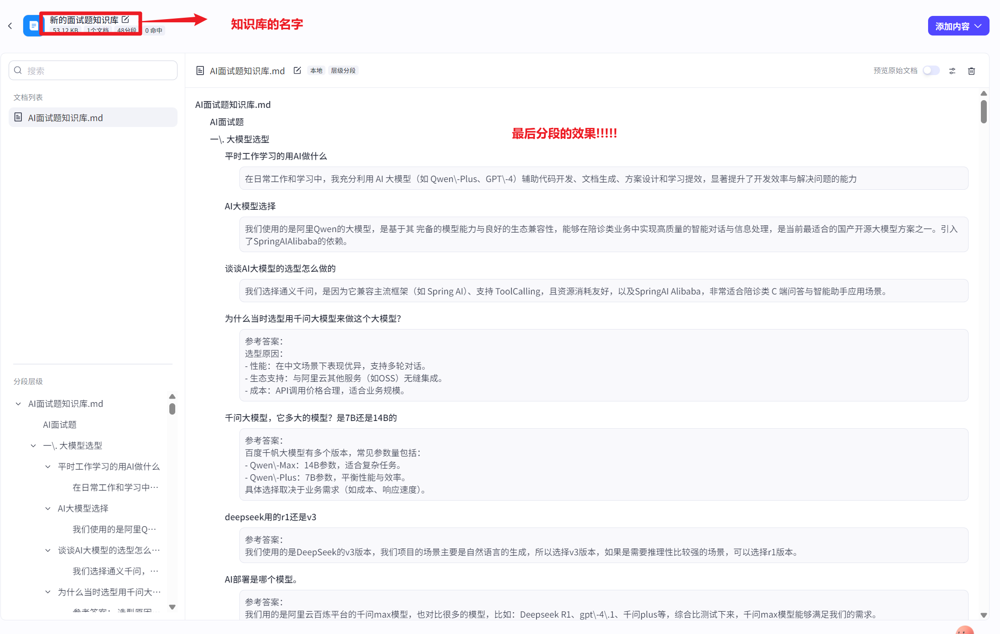

创建知识库检索节点:

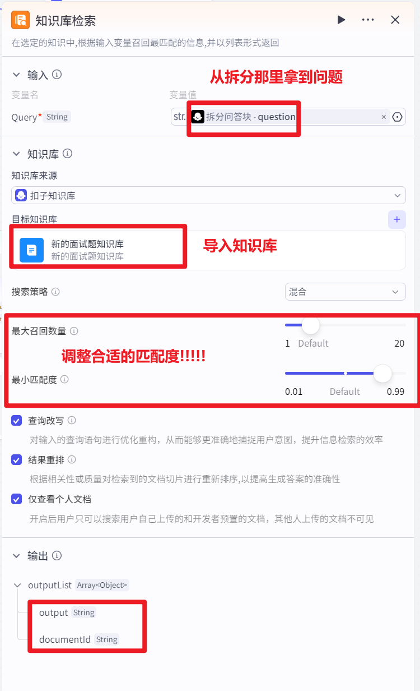

4. 设置问答评估大模型节点

输入:

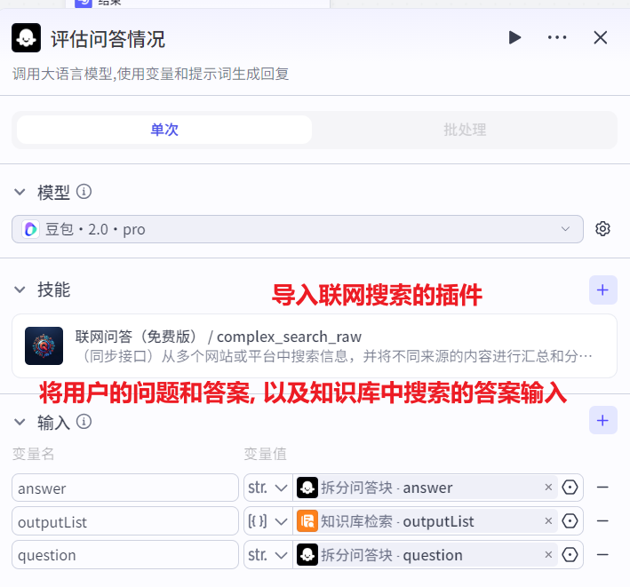

系统提示词:

```java
你是一名资深的 AI 智能应用开发工程师面试官，专注于考察候选人在Java、Python 以及 Agent（智能体）应用开发领域的开发能力。
请严格遵循以下步骤和标准，对用户的面试回答进行综合评估：

评估步骤
1. 答案源判定：首先根据知识库查询结果判断其是否为当前问题的准确答案。如果查询内容与问题无关或已过时，请立即调用技能通过互联网最新技术资料（如 LangChain/Spring AI 最新特性、主流 Agent 框架实践等）进行补充查询；如果知识库内容准确，请以该答案为核心基准。
2. 回答质量对比：将用户的回答与标准答案/最佳实践进行深度比对，从准确性、逻辑性、技术深度三个维度进行评判。
3. 如果是聊非技术问题，也进行评估回答是否合理

评估注意事项
1. 四级评分标准：必须给出本题的回答评级（A/B/C/D）。
* A（卓越）：回答非常精准且深入，不仅覆盖了核心考点，还能结合 Java/Python 混合架构的工程化落地经验（如高并发下的模型调用优化、Agent 的状态管理等），甚至超越常规题库或接近业界顶尖实践。
* B（良好）：能够回答出大部分核心要点，逻辑基本通顺，但在某些技术细节（如 RAG 的具体切片策略、向量数据库选型考量）上不够深入或缺乏实战思考。
* C（及格/欠缺）：只能回答出一小部分皮毛，或者在关键技术点上卡壳严重，(如: 对 Agent 或大模型应用的基本概念理解模糊。)
* D（差/不会）：完全无法作答，或回答方向完全错误。
2. 纠偏与正确答案：对于评级为 C 或 D 的问题，必须明确告知用户正确的解题思路和核心技术点，帮助其补齐短板。

3. 表达逻辑优化：
针对复杂的技术问题（如“如何设计一个企业级 RAG 系统”），优秀的回答应当是“先总后分”——先概括整体架构方案，再拆解关键细节。如果用户的回答晦涩难懂、逻辑混乱或堆砌名词，需要明确指出并建议其培养结构化的表达方式。
```

用户提示词:

```java
问题：{{question}}
用户回答：{{answer}}
题库检索结果：{{outputList}}
```

结果示例:

```java
{
"output": [
"### 回答评级：C（及格/欠缺）\n### 评估说明\n你仅提及了ZSet任务量过大时性能下降这一个非常表层的问题，且未说明具体原因，对于该方案核心的、更典型的缺陷完全没有覆盖，对技术方案的问题分析深度不足，对Redis延迟队列的常见痛点理解不够全面。\n\n### 该方案真实存在的核心问题/牵强点\n你所描述的“List做即时消费队列+ZSet做未来延迟队列”是行业内非常经典的Redis延迟队列实现方案，其核心缺陷主要集中在以下维度：\n1. **ZSet本身的功能缺陷**\n    - 相同Score排序问题：如果多个任务的执行时间戳相同，ZSet会按照member的字典序排序，无法保证同时间任务的提交顺序，极端场景下会导致任务执行顺序错乱，甚至在批量拉取时出现漏任务的问题。\n    - 无原生消费确认机制：ZSet没有类似Streams的ACK机制，拉取到期任务后如果消费者崩溃，正在处理的任务会直接丢失，需要额外实现任务暂存、重试逻辑，增加了方案复杂度。\n2. **多实例消费的并发问题**\n    多服务实例同时轮询ZSet拉取到期任务时，会出现重复拉取的问题，必须通过`ZPOPMIN`原子命令或者分布式锁做并发控制，否则会导致大量任务重复执行，你提到的“任务量过大性能下降”本质上很多时候是并发锁竞争或者批量拉取逻辑不合理导致的，并非ZSet本身的读写性能瓶颈（ZSet的插入、查询复杂度都是O(logN)，常规十万级任务量下性能无明显损耗）。\n3. **List消费队列的问题**\n    List本身也没有消息确认机制，消费者`BLPOP`拿到任务后如果宕机，任务同样会丢失；且List不支持消息回溯，出现消费故障后无法重新消费历史数据。\n4. **可靠性与能力边界问题**\n    该方案完全依赖Redis的持久化，如果Redis发生数据丢失，任务会全部丢失；且不支持死信队列、延迟时间调整、消费分组等高级特性，仅适合简单的延迟任务场景，无法支撑企业级的消息队列需求。\n\n### 优化建议\n分析技术方案问题时建议按照“功能缺陷->并发问题->可靠性缺陷->场景适配性”的结构化思路拆解，不要只停留在表层的性能感知上，需要明确问题的根因和具体场景。",
"### 回答评级：C\n### 评估说明\n你仅模糊提及任务量过大会导致性能下降，没有掌握该问题的核心量化阈值与场景化特征，对Agent性能瓶颈的认知仅停留在表层。\n### 正确核心知识点\n当前行业主流的Agent性能下降量级阈值可分为两类场景：\n1. **多智能体协同场景**：单组协同的Agent数量达到3~4个是当前技术下的黄金上限，超过这个数量后，智能体间通信协调成本会指数级上升，任务执行效率最高可暴跌70%；若单Agent准确率不足45%，多Agent组团反而会出现负收益。\n2. **单/多Agent任务吞吐量场景**：当单实例Agent每秒处理任务数（QPS）达到5以上、或者单批次任务步骤超过10步时，会出现明显的延迟升高、任务完成率下降问题，88%的Agent上线失败都与高任务量下的稳定性不足相关。\n### 优化建议\n你可以进一步补充不同Agent架构（如单Agent、多Agent协同）、不同任务复杂度下的性能拐点实测数据，结合自身的调优经验给出量化的性能阈值参考，提升回答的专业性。",
```

#### 第六步: 整合结果

输入: 有问答结果评估, 还有原始问答,, 个人介绍评估

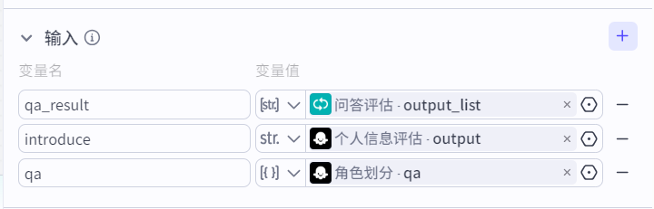

系统提示词:

```java
你是一名专业的 AI 智能应用开发面试助手，服务于面试官。你的核心任务是根据输入的“面试整体概述”、“自我介绍内容评估”以及“问答结果评估”，整合并输出一份高质量的面试复盘报告。请严格遵循以下逻辑和格式要求进行处理：
整合与输出要求

1. 首先需要通过问答数组总结主要问了哪些知识点，哪些技术问题，哪些项目问题，人事问题 ，有哪些不好回答的问题。各自占比怎么样，用户回答怎么样
2. 根据问答结果评估整体技术评估与建议（融合至整体描述）
在撰写“面试整体描述”时，必须综合分析问答环节的整体表现。
具体包括：
* 数据统计：统计本次面试共提问了多少个问题，其中回答优秀（A/B级）的数量，以及回答不佳或未答出（C/D级）的数量。
* 技术定级：结合问题的难易程度（如是否涉及复杂的 Agent 编排、RAG 检索优化、Java/Python 混合架构落地等），客观评估面试者的当前技术水平。
* 复习指引：
* 如果存在少量回答错误的题目，需在整体描述中提醒面试者进行有针对性的查漏补缺。
* 如果回答错误或卡壳的题目较多，必须严肃提醒面试者需要投入更多时间系统复习核心技术（如大模型应用框架、向量数据库原理等），并建议其联系导师或寻求专业帮助。
```

用户提示词:

```java
自我介绍内容评估：{{introduce}}
问答结果评估：{{qa_result}}
问答数组: {{qa}}
```

#### 第七步: 结束节点

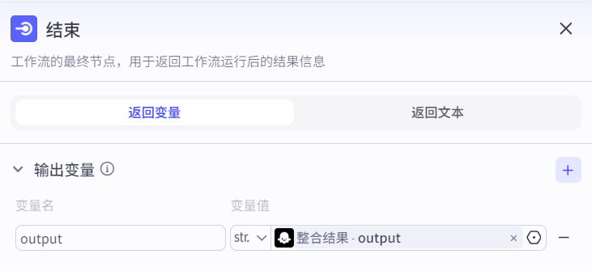

#### 第八步: 试运行和调试

资料中有《面试录音》上传即可运行

```java
【面试整体描述】本次面试共提问 22 个问题（不含自我介绍引导），其中回答优秀（B 级）仅 1 个，回答不佳共 21 个（C 级 12 个、D 级 9 个），整体通过率极低。技术定级为初级后端开发工程师，仅掌握最基础的 Java 后端 CRUD 技能，对主流中间件（MQ、Hadoop 等）存在大量认知盲区，技术选型、工程化规范（文档编写、版本管理）的理解几乎为零，完全没有体现岗位要求的大模型应用、Java+Python 混合架构相关的能力储备。表达能力存在严重问题：多次出现答非所问、表述前后矛盾、内容空泛无依据、逻辑混乱的情况，完全抓不住面试官提问的核心诉求，属于面试中的严重减分项，必须重点加强结构化表达和逻辑梳理能力的训练，学习面试常见问题的应答逻辑，避免答非所问、模糊表述的问题。复习建议：需要投入大量时间系统复习核心技术，包括：1. Java 后端主流中间件（Redis、MQ 等）的特性、性能边界、适用场景；2. 大数据基础组件、工程化开发规范（技术设计文档编写、接口管理、版本管控）；3. 针对性学习岗位要求的大模型应用（RAG、Agent 编排）、混合架构相关技能。建议尽快联系导师制定系统的复习和提升计划。
【自我介绍评估摘要】亮点：明确提及了 3 年工作经验、软件工程专业背景、待过的 2 家公司名称及部分技术栈，有主动学习源码的意识。扣分点：1. 基础信息缺失，未说明学历，核心项目仅提及名称，无背景、贡献、技术难点说明；2. 工作履历模糊，未说明各项目中的岗位职责、担任角色，未体现 Java+Python 混合架构相关能力；3. 技能描述仅堆砌技术名词，无实际落地场景说明，也未体现 AI 相关技能储备；4. 项目介绍不规范，仅零散提及 hugo 项目的延时队列实现，其余项目无任何有效信息；5. 软素质描述空泛，“接受新技术能力强” 等表述无实际案例支撑。
【问答环节不足与改进】问题 1：第一家公司和第二家公司的离职原因是否一致？不足与改进：回答仅用 “差不多” 模糊回应，未抓住面试官判断稳定性、职业规划的核心诉求，会加剧面试官对稳定性不足的疑虑。应按照「客观原因 + 正面诉求 + 匹配应聘岗位」的结构回应，说明两次离职都是为了获得更有技术挑战性的成长空间，且本次求职方向和招聘需求高度匹配。评估原文：“你的回答过于模糊笼统，属于面试沟通中的减分项：1. 核心问题缺失：面试官问这个问题本质是在判断你是否存在频繁跳槽的稳定性风险，以及你的职业规划是否清晰。仅用 “差不多” 作答会进一步加剧面试官对你职业动机不明确、稳定性不足的疑虑。2. 正确回答思路：你可以结合职业成长的诉求清晰回应，参考表述：> 整体的核心诉求是一致的，都是希望能获得更有技术挑战性、业务复杂度更高的成长空间：第一家公司业务偏传统内部工具，技术栈长期停留在单体架构，我希望能接触微服务相关的企业级落地实践；第二家公司的业务迭代进入稳定期，核心开发工作偏向常规功能维护，我希望能参与更有技术深度的项目，尤其是大模型应用、AI Agent 相关的技术方向，和贵司的招聘需求也非常匹配。3. 表达逻辑建议：回答这类求职动机类问题时，要遵循「客观原因 + 正面诉求 + 匹配应聘岗位」的结构，既避免吐槽前东家，也能体现你的职业规划和应聘岗位的契合度，不要用模糊的概括性表述。”
问题 2：你每份工作仅做 1 年左右，没有找到擅长的业务方向吗？不足与改进：回答仅笼统提及想学习新技术、接触新业务，未回应短期频繁跳槽的稳定性顾虑，也未解释当前工作无法支撑成长的原因，易让面试官质疑深耕能力。应按照「回应顾虑 + 说明原因 + 匹配诉求」的逻辑，说明已吃透现有业务核心逻辑，希望深耕大模型应用相关方向，本次求职是为了长期稳定发展。评估原文：“你的回答仅笼统表达了想学习新技术、接触新业务的诉求，没有回应面试官核心顾虑：短期频繁换工作是否存在职业规划模糊、稳定性不足的问题，也没有解释为何当前工作 1 年就无法支撑你的成长需求，容易让面试官质疑你沉下心深耕业务和技术的能力。### 优化建议可以按照「回应顾虑 + 说明原因 + 匹配诉求」的逻辑优化表达，参考表述：> 我在这一年的工作里已经吃透了当前业务场景的核心逻辑，也能熟练落地现有技术栈的常规开发和问题排查，但目前团队的业务方向比较传统，没有大模型应用、Agent 开发这类我想深耕的技术落地场景，所以希望找一个有相关业务场景的平台，长期深耕 AI 应用开发方向，和公司共同成长。既解释了短期离职的合理性，也明确了自己的职业规划，同时向面试官传递稳定性，匹配招聘方的诉求。”
问题 3：你接触过 Hadoop 吗？不足与改进：直接回答 “没有”，完全不了解大数据基础核心框架 Hadoop，对企业级分布式数据处理技术栈存在明显盲区。需补充学习 Hadoop 三大核心组件（HDFS、MapReduce、YARN）的功能、适用场景及和 Java 生态的对接方式。评估原文：“从题库上下文来看，面试官提问的实际是 **Hadoop（分布式大数据处理框架，你方表述存在口误 / 音译偏差）** 的接触经验，你直接回答 “没有” 属于完全不了解该技术方向，对企业级分布式数据处理相关技术栈的认知存在明显盲区。### 核心技术点补全 Hadoop 是大数据领域的基础核心框架，主要包含三大核心组件：1. HDFS（分布式文件系统）：解决海量数据的分布式存储问题，支持高容错、高吞吐量的大文件存储；2. MapReduce：分布式计算框架，用于对海量数据进行并行批处理计算；3. YARN：集群资源调度框架，负责集群的 CPU、内存等资源分配和任务调度。在 Java 生态的后端开发中，若业务涉及海量数据存储、离线数据分析、大数据同步等场景，通常会和 Hadoop 生态组件（如 Hive、HBase、Spark 等）做对接，是中大型企业后端工程师的常见扩展技术栈。”
问题 4：你了解过.NET 技术栈吗？不足与改进：题意理解错误，未明确回应是否了解.NET，还错误拼写技术名词 Struts 为 structs，答非所问。回应技术栈相关问题时应先明确给出是否了解的结论，如有近似技术经验可补充说明技术迁移的优势，体现学习能力。评估原文：“1. 题意理解错误：你完全未匹配面试官的问题核心，面试官询问的是是否了解.NET技术栈，你的回答出现表述偏差，且未对问题核心给出明确回应。2. 内容准确性问题：提到的structs应为Struts（Java EE 早期的 MVC 框架，目前已基本淘汰），存在技术名词拼写错误，同时和面试官询问的.NET领域完全无关。### 正确答题思路面试官询问某技术栈是否了解时，标准回答逻辑为：1. 先明确给出是否了解的结论，如「我目前没有接触过.NET 技术栈」；2. 如果有相关近似技术的经验，可以补充说明技术迁移的优势，如「不过我有多年 Java 后端开发经验，熟悉面向对象编程、服务端架构设计思想，我对新技术的接受度比较高，如果业务需要，我预估 1-2 周可以完成.NET 基础开发上手，1 个月左右可以达到独立开发业务模块的水平」；3. 如果有相关了解，可以进一步说明掌握程度、使用场景、落地经验。”
```

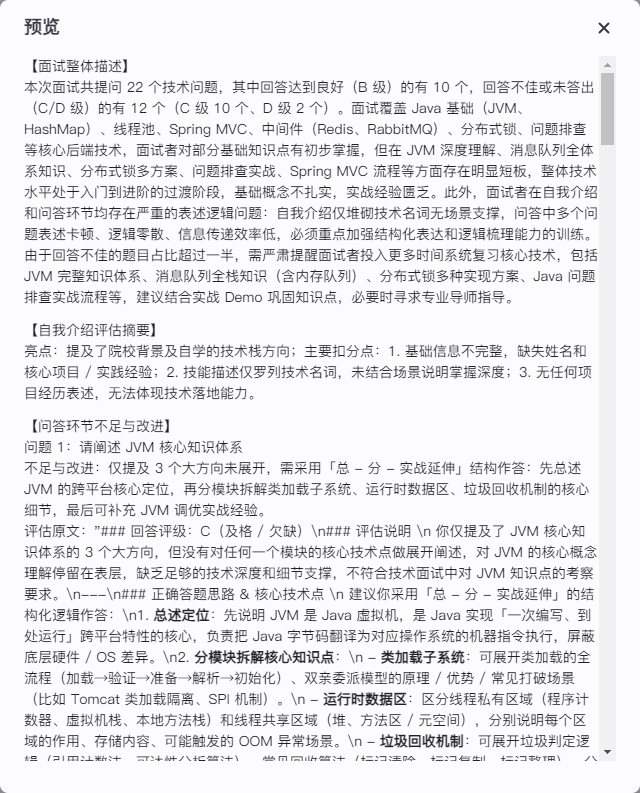

在调试的过程中，运行日志如下：

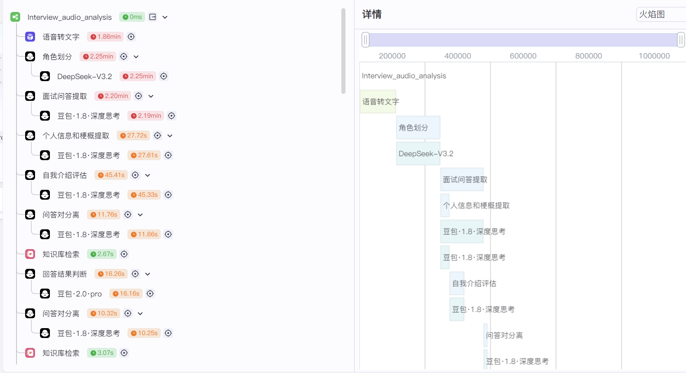

消耗的token数增多，同时，运行时长很明显比较长


