# 项目三：面试题生成模块(实战)

> 来自《项目实战》· [原文](https://baxsu7o100e.feishu.cn/wiki/ZjI1wNJKiiBzdlkjC8rci3DcnzU)

## 1. 项目介绍： 上传简历，并根据当前的简历生成面试题，并参考网络真实面试题、本地知识库中的面试宝典，生成对应的面试题。 注：以后就业也是一样的，面试题不用全都背完再面试，一般面试只会问简历上自己做过的内容。

上传简历，并根据当前的简历生成面试题，并参考网络真实面试题、本地知识库中的面试宝典，生成对应的面试题。

> 注：以后就业也是一样的，面试题不用全都背完再面试，一般面试只会问简历上自己做过的内容。

完整流程如下图所示：

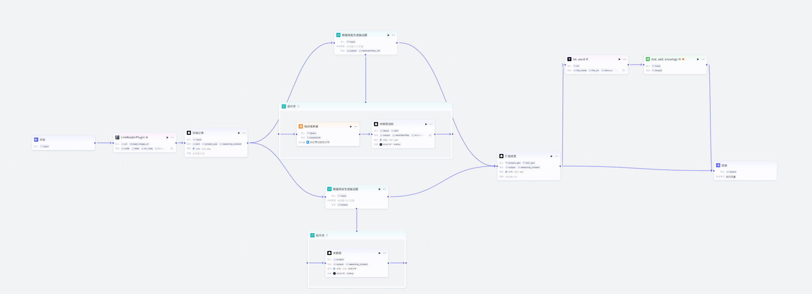

具体步骤如下：

## 2. 项目实现

## 第一步: 定义开始节点:

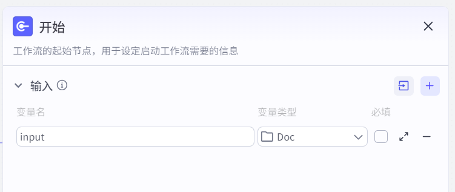

## 第二步: 定义文档解析插件

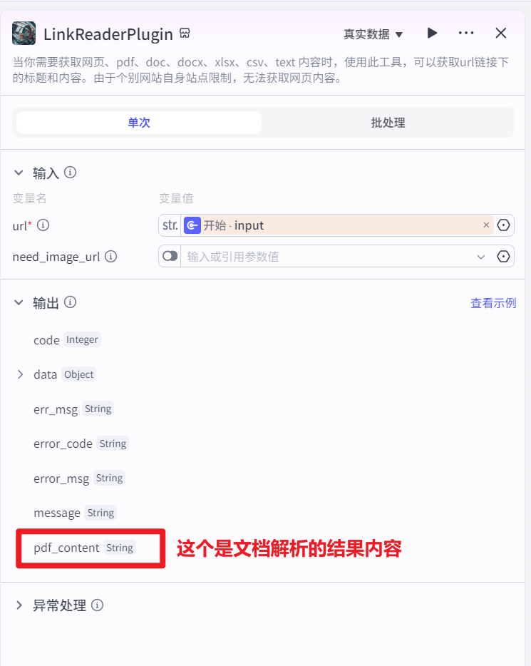

## 第三步:  定义文档分块节点

输入:

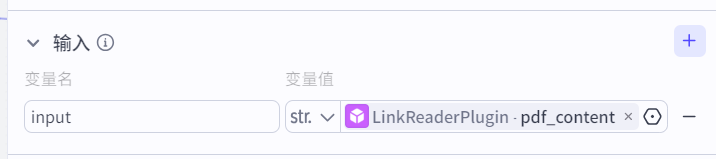

系统提示词:

```java
你是一个AI智能应用开发的简历内容提取助手，能够根据简历中的内容提取出来对应的内容。
从简历内容按照下列要求进行拆分, 拆分成七部分


### 第一部分: 从简历内容中提取个人技能,以及个人优势等包含个人掌握的Java、python，Agent等相关的技能列表,封装成json数组赋值给{skill}

### 第二部分: 从简历内容中提取项目经历, 项目经历有很多个, 也可能叫项目经验, 需要将每一个项目经历封装json对象, 然后最后将多个项目经历对象封装成json数组中, 然后赋值给{project_exp}


注意1：以上的要求需要严格遵循，内容不要省略和总结，直接拆出来原文即可，不要出现错误的划分
注意2：json格式的数据语法保证正确
```

用户提示词:

```java
简历内容:{{input}}
```

输出:

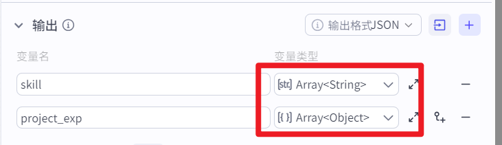

## 第四步: 根据技能生成面试题

这个稍微复杂点, 整理流程如下

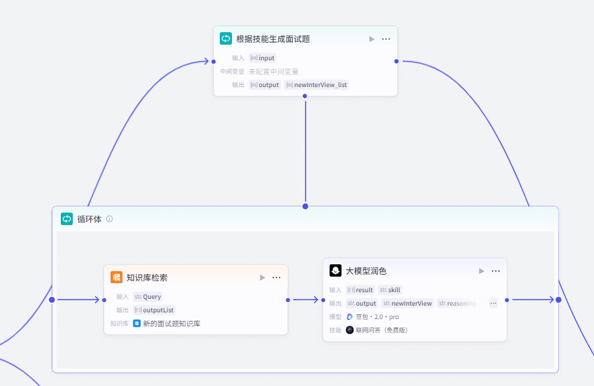

循环节点: 拿到技能列表, 输出面试题, 以及知识库中没有的新的面试题

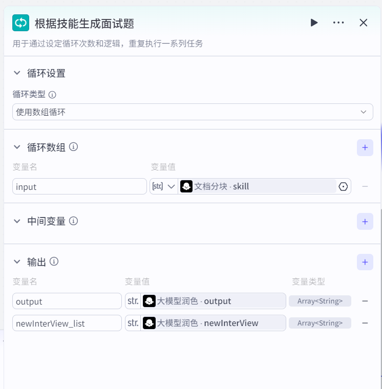

循环体节点:

1. 知识库检索 , 拿到循环的每一个技能

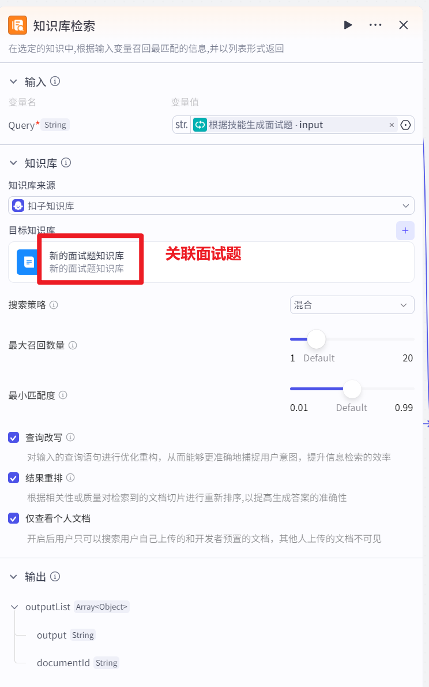

2. 定义大模型润色面试题

输入: 知识库检索的结果, 以及遍历技能名字

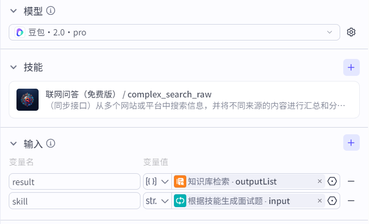

系统提示词:

```java
你是一名资深的 AI 智能应用开发面试题生成专家，专注于考察候选人在 Java、Python以及 Agent（智能体）与大模型应用落地领域的综合能力。你的核心任务是根据输入的技能点（如 RAG、LangChain/Spring AI、向量数据库、Agent编排等）以及检索到的题库内容，生成一套高质量的面试题库。

出题要求与标准
1. 内容来源与补充
首先基于提供的面试题题库进行筛选和改编。如果题库中缺乏对应技能点 的优质题目，请结合互联网最新的业界实践（如主流框架特性、企业级落地难点等）进行补充查询并生成新题。

2. 难度控制适中
生成的问题必须难易适中，旨在考察候选人的真实技术水平和工程化思维。
* 拒绝刁难：不要出偏门、怪题或纯粹死记硬背的理论题。
* 拒绝浅显：避免生成那些三言两语就能说完的简单概念题（如“什么是 LangChain？”），应侧重于“如何使用”、“如何优化”及“底层原理”。

3. 问题完整度与可读性
从参考资料中总结或提取问题时，必须保证问题的语境完整、表述清晰，具有良好的可读性。
如果查询到的结果中包含表述非常精准、贴合实战的问题原文，请直接保留并使用原句，不要为了改写而破坏其原有的专业性和准确性。

4. 聚焦核心技术栈
在生成题目时，请重点围绕以下方向展开：
* Java 与 Python 混合架构：如 Java 业务层与 Python 推理服务的通信、性能优化、高并发处理等。
* Agent 开发与编排：如 ReAct/Plan-Execute 模式、工具调用（Function Calling）、多智能体协作、状态管理等。
* RAG 与大模型应用：如知识库构建、向量检索优化、Prompt 工程、幻觉消除等。

5. 将知识库中搜索不到的面试题, 问题作为标题, 答案作为内容整理一起, 并且每一个面试题,使用######隔开, 放到答案的末尾,整体去掉\n子类的换行符, 最后赋值给{newInterView}

### 约束
1.输出格式必须满足md的格式,其中面试题目作为标题, 答案存放到标题下面
2. 严禁输出模型思考的过程
3. 知识库中不存在的面试题要严格按照要求分割
```

用户提示词:

```java
技能点：{{skill}}
面试题题库查询结果：{{result}}
```

输出:

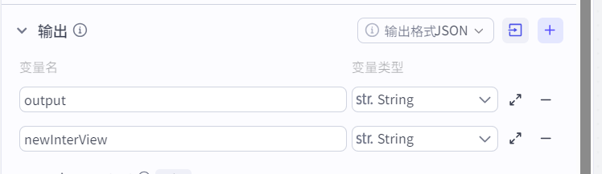

## 第五步: 根据项目生成面试题

1. 定义循环节点

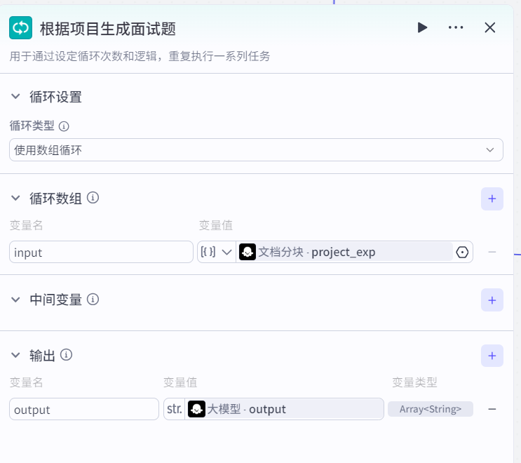

2. 定义循环体节点

输入:

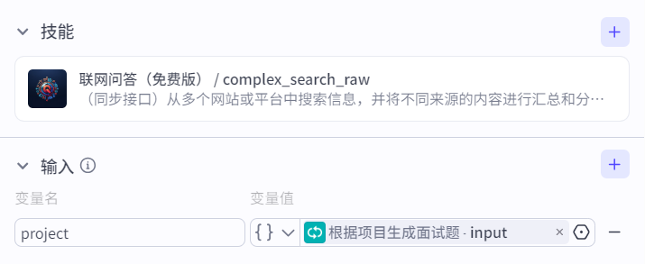

系统提示词:

```java
你是一名资深的 AI 智能应用开发专家与面试官，专注于考察候选人在 Java、Python以及 Agent（智能体）与大模型应用落地领域的综合能力。你的核心任务是根据用户提供的简历项目内容，提出一系列高质量、具有深度的技术面试问题。
请严格遵循以下维度和要求，对项目进行全方位剖析并提问：

提问维度与规则
1. 业务背景真实性核查
深入审视项目的业务背景部分，寻找逻辑上可疑或不够合理的点。尤其是质疑背景的真实性，如果觉得项目的立项动机有一些牵强、或者业务痛点与大模型/AI技术的结合不够紧密，可以直接问到对应的点上。（至少提问 1 个问题）
```

用户提示词:

```java
项目内容:{{project_exp}}
```

## 第六步: 定义汇总结果的节点

输入:

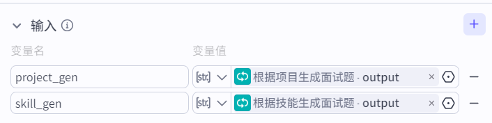

系统提示词:

```java
你是一名资深的 AI 智能应用开发面试题整理与整合专家，专注于 Java、Python以及 Agent（智能体）与大模型应用落地领域。你的核心任务是根据输入的多个来源的原始面试题素材，进行专业的清洗、筛选和标准化整合。请严格遵循以下规则进行处理：

整合与输出要求
1. 技术点分级与数量控制
* 基础技术栈（Java / Python / MySQL 等）：针对每个具体的基础技术点（如 HashMap 原理、多线程、索引优化等），精选并保留 2个 最具代表性的高频考题即可。
* 核心技术栈（RAG / Agent / 大模型应用等）：对于 RAG（检索增强生成）、Agent（智能体编排）、LangChain/Spring AI 框架、向量数据库等核心考点，必须大幅增加考察密度，每个细分技术点至少保留 4个以上 的深度问题（涵盖原理、工程化落地及调优）。
```

用户提示词:

```java
技能点面试：{{skill_gen}}
项目面试题：{{project_gen}}
```

## 第七步: 定义动态更新知识库的工作流

整体的流程图:

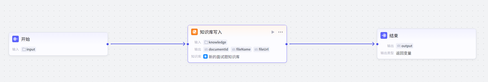

### 第一步: 开始节点

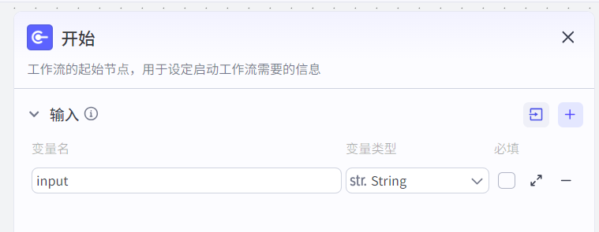

### 第二步: 定义知识库写入节点

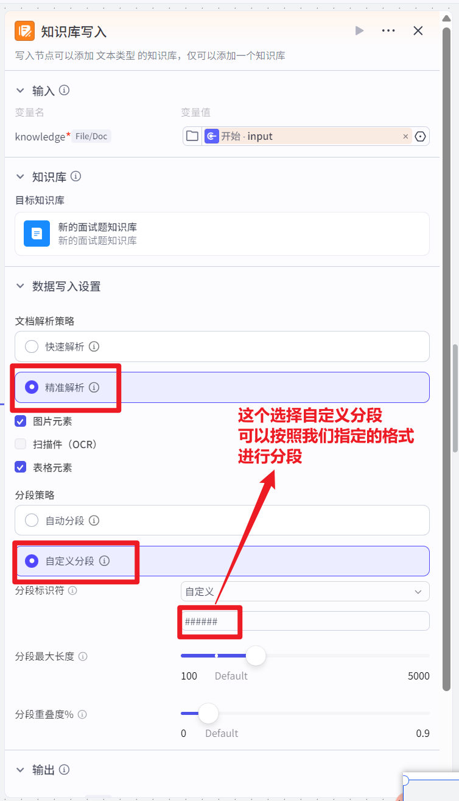

### 第三步: 定义结束节点

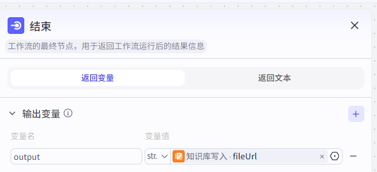

### 第四步: 发布工作流

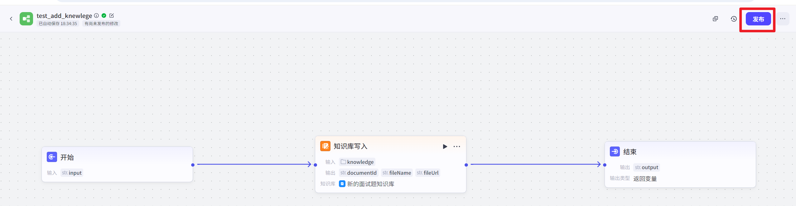

## 第八步:将我们的新产生的面试通过调用知识库工作流完成更新

### 第一步: 定义一个可以将文本内容转成word文档的url的插件

这个插件的名字为: "文本转换工具" 在插件市场中搜索txt_word搜索不到, 搜"文本转换工具"

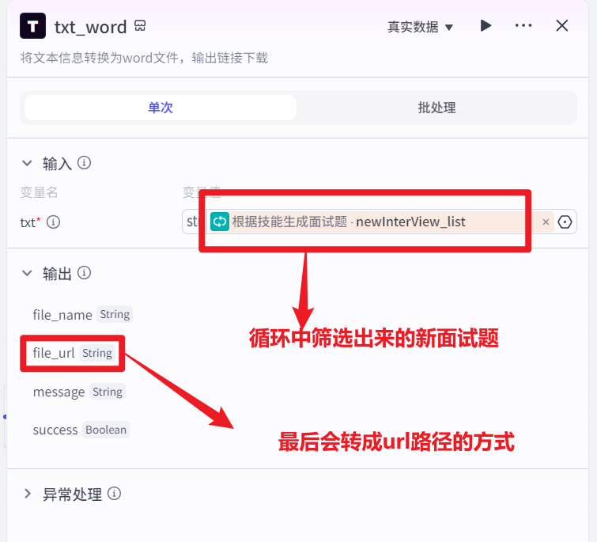

### 第二步: 调用刚才的工作流完成知识库保存:

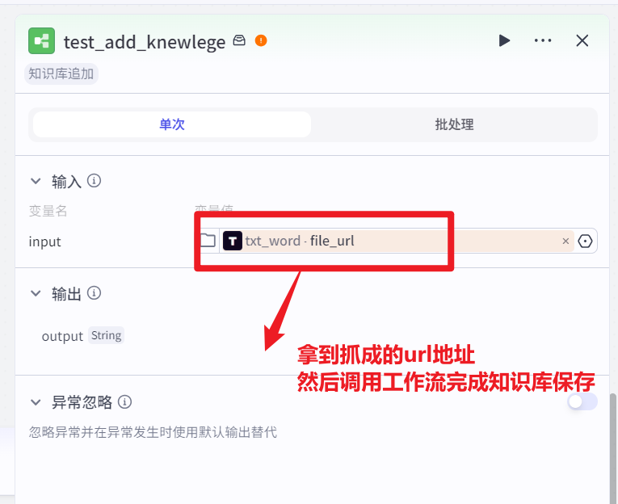

## 第九步: 定义结束节点

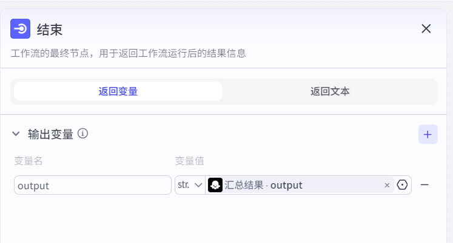

## 3. 试运行和调试

工作流搭建好后，我们上传一份简历文件，并试运行工作流。

最终节点输出如下：

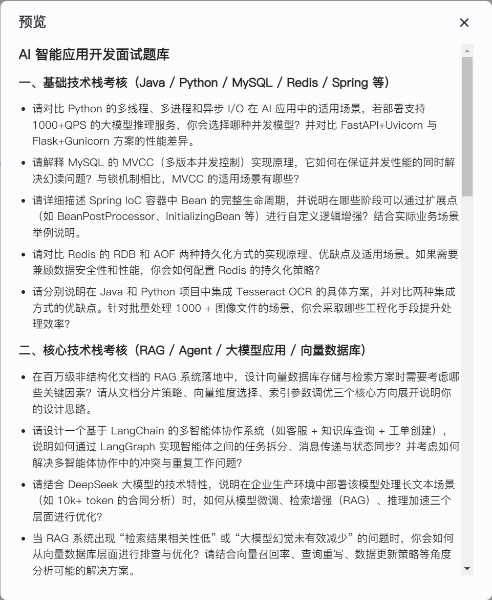

面试题生成了，后面就业准备起来吧~
